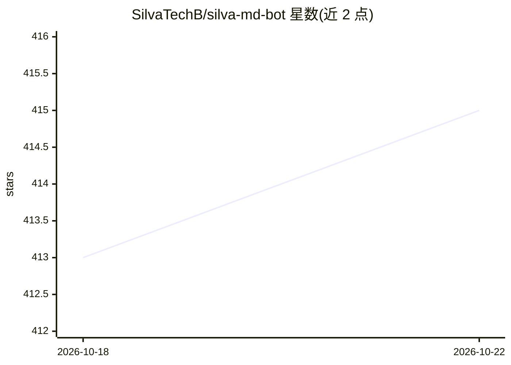

# SilvaTechB/silva-md-bot

⭐ 415 · JavaScript · MIT · 推送 2026-10-10 · [GitHub](https://github.com/SilvaTechB/silva-md-bot) · [官网](https://silva-session-selector.vercel.app/) · 组织维护

**给 WhatsApp 用户的多设备自动化机器人：1500+ 命令与群管功能**

基于 Node.js 的 WhatsApp 多设备机器人，通过 Session ID 关联用户 WhatsApp 账号运行，自称含 1500+ 命令。功能覆盖防护（拒接来电、防删消息、防链接、防刷屏）、媒体下载（YouTube/TikTok/Instagram/Facebook）、群管理（踢人、警告、欢迎语、投票）、游戏与 15 种人格主题。其中 AI 部分为聊天助手、TTS、翻译等命令。支持一键部署到 Silva Host、Heroku、Railway、Koyeb、Replit 等平台，或本地克隆源码用 PM2 常驻运行；需 Node.js 20+ 与 Git。

## 筛选速览

| 维度 | 判定 | 备注 |
|---|---|---|
| AI 角色 | `ai-enhanced` | 去掉 AI 部分产品仍成立 |
| 许可风险 | `permissive` | MIT |
| 部署形态 | `library` | 以包/库形式分发 |
| 模型依赖 | — | README 未给出锁定关系 |
| 硬件要求 | — | 无带数字的原话,不猜 |
| 安装摩擦 | `low` | 无编译、无系统依赖或容器化 |
| 成熟度 | — | 结构信号不足 |

## 能力要点

- 1500+ 命令，覆盖防护、媒体下载、群管、游戏与 AI 工具
- 一键部署到 Silva Host/Heroku/Railway/Koyeb/Replit 五种平台
- 15 种可切换的人格主题（动漫/影视角色风格）
- 防护套件：拒接来电、恢复已删消息、揭示阅后即焚媒体

## 适用场景

- 让自己的 WhatsApp 账号自动回复、管理群成员与欢迎消息
- 在聊天里直接下载 YouTube/TikTok/Instagram 等平台媒体
- 给群组加防链接、防刷屏、防垃圾等保护规则

## 场景标签

`聊天机器人` · 领域:对话与助手

## 证据(README 行号)

> L5: > **A powerful multi-device WhatsApp bot — 1500+ commands, AI agent, 19 smart features, anti-ban protection.**
> L150: ## ✨ Features

## 星数曲线

2026-10-18 413 → 2026-10-22 415（+2）

---
*卡片 v1 · prompt 1.4 · 生成 2026-10-21 · 置信度 low · 依据 README sha `8e9346d383af` · [字段定义](../../DATASET.md)*
