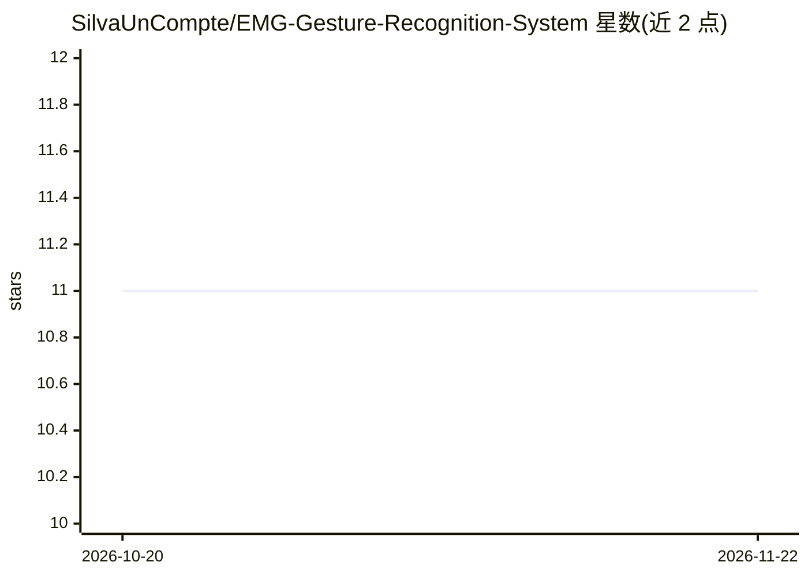

# SilvaUnCompte/EMG-Gesture-Recognition-System

⭐ 11 · Jupyter Notebook · 推送 2026-04-07 · [GitHub](https://github.com/SilvaUnCompte/EMG-Gesture-Recognition-System) · 个人维护

**基于 Myo 手环 EMG 信号的 MLP 手势分类系统**

读取 8 通道 EMG 传感器（如 Myo Armband）的 CSV 数据，训练 MLP 神经网络对 5 种手势（rest/fist/pinch/wrist-back/wrist-forward）进行分类；训练流程含数据清洗、标准化、交叉验证与超参数优化，模型以 joblib 导出并按时间戳版本化。通过 FastAPI 提供 /predict 接口，含置信度阈值、Top-K 预测与输入校验，也可用 CLI 直接预测；面向需要 EMG 手势识别的开发者与科研用户。

## 筛选速览

| 维度 | 判定 | 备注 |
|---|---|---|
| AI 角色 | `ai-native` | 本体是模型或模型工具 |
| 许可风险 | `none` | — |
| 部署形态 | `library` | 以包/库形式分发 |
| 模型依赖 | — | README 未给出锁定关系 |
| 硬件要求 | — | 无带数字的原话,不猜 |
| 安装摩擦 | `low` | 无编译、无系统依赖或容器化 |
| 成熟度 | — | 结构信号不足 |

## 能力要点

- 8 通道 EMG 信号的 MLP 手势分类，当前支持 5 种手势
- FastAPI REST 接口与 CLI 两种预测方式，置信度低于 0.6 返回 unknown
- 训练流程含交叉验证、混淆矩阵/ROC 可视化与 Optuna 超参数优化
- 模型自动时间戳版本化，导出 pipeline/config/metrics 元数据

## 适用场景

- 用 Myo Armband 数据训练自己的手势分类模型
- 通过 REST API 或命令行识别 8 通道 EMG 手势
- 科研场景下实验 MLP 超参数与架构对比

## 场景标签

`科研工具` · 领域:学习与行业

## 证据(README 行号)

> L3: Machine learning system for recognizing hand gestures using Myo Armband (EMG) sensor data.
> L5: It uses neural networks (Multi-Layer Perceptron) and exposes recognition through a web API.
> L100:   "label": "wrist-back",

## 星数曲线

2026-10-20 11 → 2026-11-22 11（+0）

---
*卡片 v1 · prompt 1.4 · 生成 2026-11-18 · 置信度 high · 依据 README sha `f5bf1b08e1b7` · [字段定义](../../DATASET.md)*
