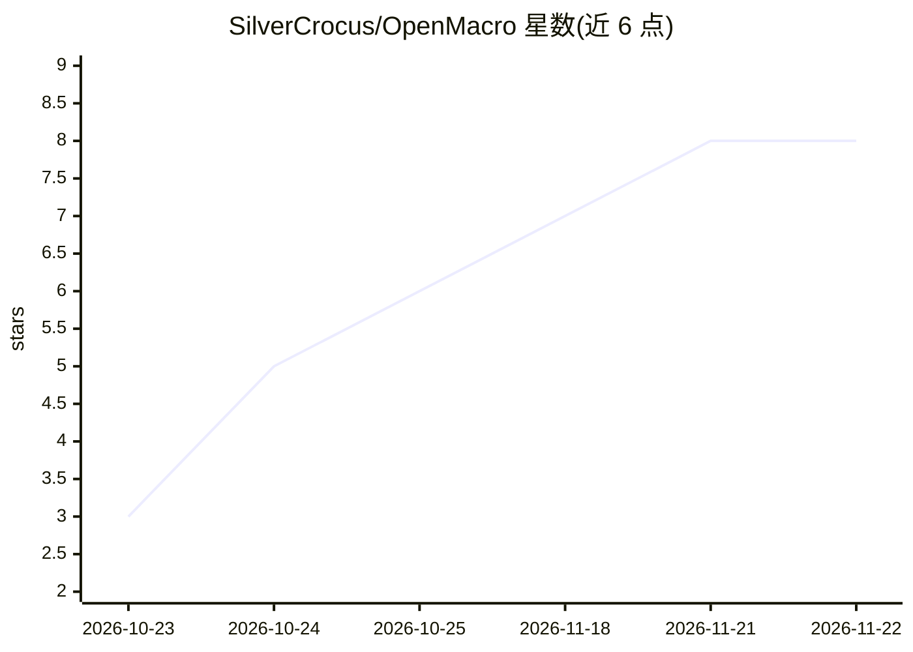

# SilverCrocus/OpenMacro

⭐ 8 · Rust · MIT · 推送 2026-11-19 · [GitHub](https://github.com/SilverCrocus/OpenMacro) · 个人维护

**安卓本地优先营养教练：自适应热量目标与 AI 拍照记录**

Android 营养记录应用，用 Rust（Dioxus）编写：基于体重与饮食数据每周校准热量与宏量营养素目标，提供 58,000 种食物库、条码扫描、食谱与喝水记录、体重趋势与 Health Connect 同步。AI 部分为拍照或文字描述识别食物并填充餐盘，支持自带 API key（Gemini/OpenRouter/OpenAI/Anthropic/Ollama）。无账号、数据存本地、可离线使用，MIT 许可，通过 APK 或 Obtainium 安装。

## 筛选速览

| 维度 | 判定 | 备注 |
|---|---|---|
| AI 角色 | `ai-enhanced` | 去掉 AI 部分产品仍成立 |
| 许可风险 | `permissive` | MIT |
| 部署形态 | `None` |  |
| 模型依赖 | local-ok | 支持本地模型 |
| 硬件要求 | — | 无带数字的原话,不猜 |
| 安装摩擦 | `low` | 无编译、无系统依赖或容器化 |
| 成熟度 | — | 结构信号不足 |

## 能力要点

- 基于自体数据的 TDEE 估计与每周打卡调整目标
- 拍照/描述 AI 记录饮食，支持自然语言更正
- 58,000 种食物（USDA/FSANZ/Open Food Facts）+ 条码扫描
- 无账号、本地存储、离线可用、CSV 导出与 Health Connect 同步

## 适用场景

- 不用订阅制教练应用，本地管理减脂/增重饮食目标
- 拍一张餐照快速记录一餐并在识别有误时口头更正
- 离线记录饮食并同步体重数据到 Health Connect

## 场景标签

 · 领域:健康/营养追踪

## 证据(README 行号)

> L6:  Calorie and macro targets that adapt to your body, logging in seconds (even from a photo),
> L31: - ⚡ **Fast logging.** Search 58,000 foods, scan barcodes, reuse recipes and recent foods, copy whole meals, or snap
> L62: - AI logging from a photo or a description, with corrections in plain words

## 星数曲线

2026-10-23 3 → 2026-11-22 8（+5）

---
*卡片 v1 · prompt 1.4 · 生成 2026-11-21 · 置信度 high · 依据 README sha `eeb007c88674` · [字段定义](../../DATASET.md)*
