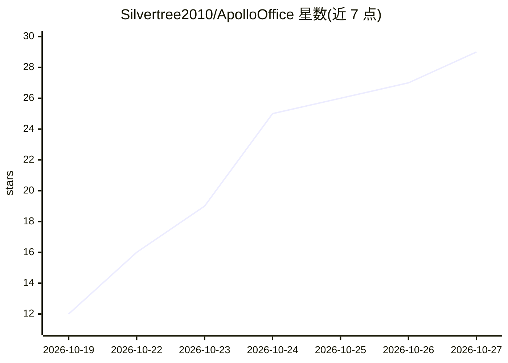

# Silvertree2010/ApolloOffice

⭐ 29 · Rust · AGPL-3.0 · 推送 2026-10-25 · [GitHub](https://github.com/Silvertree2010/ApolloOffice) · [官网](https://office.apollonet.dev) · 个人维护

**本地运行的 AI 工人团队：把 GitHub issue 变成经验证的修复 PR**

Rust 单二进制桌面应用，在用户自己的电脑上运行一组流水线 AI 工人（Scout/Guard/Vet/Repro/Fixer/Reviewer/Submit/Watcher 等），负责发现或接收 bug 报告、复现、编写带回归测试的修复、验证测试在修复前失败修复后通过、运行项目测试并开 PR（默认需人工批准）。每个工人可单独选择提供方：Claude Code/Codex 登录、Claude/OpenAI/Gemini API key 或本地 Ollama。执行在 Docker 隔离中进行，GitHub token 不离开本机。限制：自述为 beta，需 git 与 GitHub CLI。

## 筛选速览

| 维度 | 判定 | 备注 |
|---|---|---|
| AI 角色 | `ai-ecosystem` | LLM/agent 周边工具 |
| 许可风险 | `viral` | AGPL-3.0 |
| 部署形态 | `None` |  |
| 模型依赖 | local-ok | 支持本地模型 |
| 硬件要求 | — | 无带数字的原话,不猜 |
| 安装摩擦 | `low` | 无编译、无系统依赖或容器化 |
| 成熟度 | `idea` | |

## 能力要点

- 固定流水线工人：复现→修复→回归测试证明→开 PR
- 每个工人可独立配置提供方（Claude Code/Codex/OpenAI/Gemini/Ollama）
- Docker 隔离执行，token 不离开本机，PR 默认等待人工批准
- 成本与预算统计、Sentry/GlitchTip/CI 失败报告接入、PR 跟踪与自动 rebase

## 适用场景

- 让 AI 工人在本地自动处理仓库的 bug issue 并提交修复 PR
- 从 Sentry/GlitchTip 告警或 CI 失败自动生成 bug 修复
- 跟踪已开 PR 的合并请求与冲突并自动 rebase

## 场景标签

`编码 Agent` `代码审查` · 领域:编码与开发

## 证据(README 行号)

> L3:  A small office of AI workers that turns GitHub issues into verified pull
> L42: - **Any provider per worker.** Claude Code or Codex with your own login, or
> L38: - **A fixed pipeline** of small workers: Scout, Guard, Vet, Hunter, Repro,

## 星数曲线

2026-10-19 12 → 2026-10-27 29（+17）

---
*卡片 v1 · prompt 1.4 · 生成 2026-10-26 · 置信度 high · 依据 README sha `93fffa693071` · [字段定义](../../DATASET.md)*
