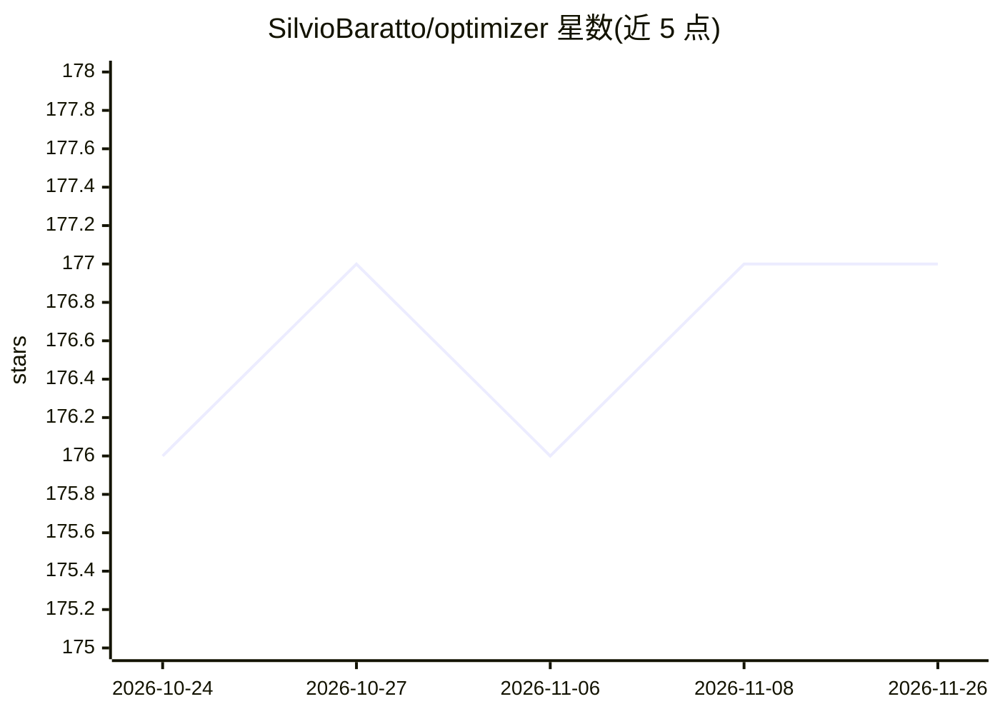

# SilvioBaratto/optimizer

⭐ 177 · Python · NOASSERTION · 推送 2026-11-25 · [GitHub](https://github.com/SilvioBaratto/optimizer) · 个人维护

**面向量化投资者的组合优化工作区，含 LLM 基金代理与模拟交易**

由四个 Python 包组成的 uv 工作区：可组合的 skfolio/scikit-learn 组合优化库（26 个子模块、15 种优化器构建器，含风险、衍生品、信用模型等研究工具）、定时拉取行情入库 PostgreSQL 的采集守护进程、共享数据库层，以及一个 LLM 代理基金桥——LLM 做选择、优化器计算，模拟交易需人工审批后执行。库可独立安装、无 Docker/DB 依赖；守护进程与基金桥需 Docker+PostgreSQL。

## 筛选速览

| 维度 | 判定 | 备注 |
|---|---|---|
| AI 角色 | `ai-enhanced` | 去掉 AI 部分产品仍成立 |
| 许可风险 | `none` | NOASSERTION |
| 部署形态 | `self-host` | docker 或自建部署 |
| 模型依赖 | local-ok | 支持本地模型 |
| 硬件要求 | — | 无带数字的原话,不猜 |
| 安装摩擦 | `low` | 无编译、无系统依赖或容器化 |
| 成熟度 | — | 结构信号不足 |

## 能力要点

- 组合优化库含 15 种优化器与 26 个子模块，纯 Python 无 DB 依赖
- LLM 代理基金：LLM 决策、优化器计算、模拟交易经人工审批门
- 定时市场数据采集守护进程，yfinance Screener 构建标的池
- 安装向导加密管理 API 密钥（Fernet+scrypt）与生命周期命令

## 适用场景

- 在自己的代码中构建和调优组合优化流水线
- 定时维护行情/基本面/宏观数据的 PostgreSQL 存储
- 让 LLM 代理提出配置方案，人工审批后模拟交易

## 场景标签

`金融量化` · 领域:学习与行业

## 证据(README 行号)

> L3: > Portfolio optimization in one **uv workspace**: a composable skfolio /
> L22: |Build and tune portfolio-optimization pipelines in your own code|the **`optimizer`** library (`portopt-core`)|**No
> L25: |Run an LLM-driven fund manager that decides and lets the optimizer compute|the **`fund`** bridge (`portopt-fund`)|

## 星数曲线

2026-10-24 176 → 2026-11-26 177（+1）

---
*卡片 v1 · prompt 1.4 · 生成 2026-11-26 · 置信度 mid · 依据 README sha `32acfd553e20` · [字段定义](../../DATASET.md)*
