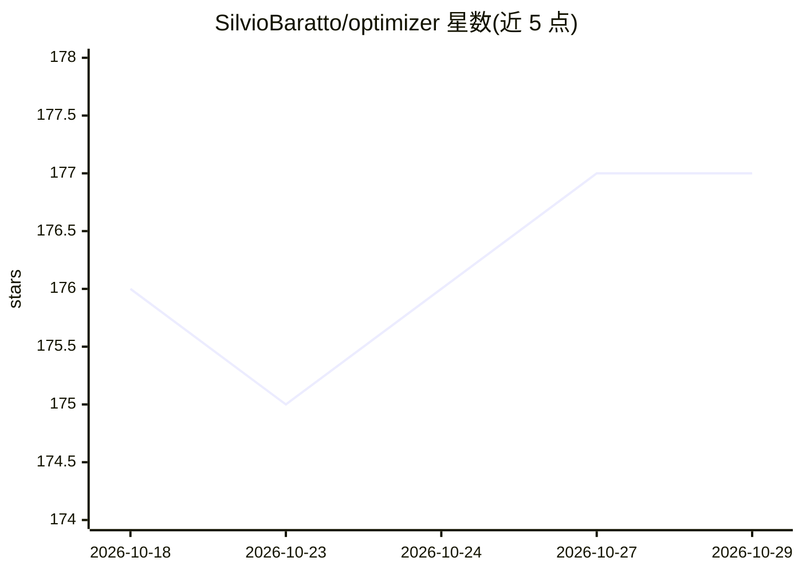

# SilvioBaratto/optimizer

⭐ 177 · Python · NOASSERTION · 推送 2026-10-26 · [GitHub](https://github.com/SilvioBaratto/optimizer) · 个人维护

**量化组合构建与优化平台：库+数据守护进程+LLM 基金经理**

由四个共享一个 uv 工作区的 Python 包组成：portopt-core 是纯 Python 组合优化库（基于 skfolio/scikit-learn，含 15 个优化器构建器、18 个子模块，无 Docker/DB 依赖）；portopt 是无头市场数据摄取守护进程（APScheduler 定时抓取 yfinance/FRED 等，需 Docker+PostgreSQL）；portopt-db 提供共享 SQLAlchemy 数据层；portopt-fund 用 deepagents/langgraph 让 LLM 做组合决策、由优化库计算，支持十个 LLM 提供商（默认 Ollama Cloud 上的 DeepSeek），含人工审批环节。面向量化开发者，需 Python ≥ 3.12。

## 筛选速览

| 维度 | 判定 | 备注 |
|---|---|---|
| AI 角色 | `ai-enhanced` | 去掉 AI 部分产品仍成立 |
| 许可风险 | `none` | NOASSERTION |
| 部署形态 | `self-host` | docker 或自建部署 |
| 模型依赖 | local-ok | 支持本地模型 |
| 硬件要求 | — | 无带数字的原话,不猜 |
| 安装摩擦 | `low` | 无编译、无系统依赖或容器化 |
| 成熟度 | — | 结构信号不足 |

## 能力要点

- 18 个子模块的组合优化库，15 个优化器构建器（Mean-Risk/HRP/HERC/NCO/CVaR 等）
- 优化库零 Docker/DB 依赖，纯 pip 可装
- APScheduler 驱动的 7 任务市场数据摄取守护进程（PostgreSQL 存储）
- LLM 基金经理：十提供商注册表 + 人工在环审批（fund approve/reject）

## 适用场景

- 在自己的代码中构建和调参组合优化流水线
- 定时抓取并存储市场/宏观/基本面数据
- 让 LLM 决策调仓、数值计算交给优化器并留审计记录

## 场景标签

`金融量化` · 领域:学习与行业

## 证据(README 行号)

> L21: |Build and tune portfolio-optimization pipelines in your own code|the **`optimizer`** library (`portopt-core`)|**No
> L37: |`packages/portopt-core/` (declared from the repo-root `pyproject.toml`)|`portopt-core`|`optimizer`|Pure-Python opt
> L222: The `fund` bridge lets an LLM make portfolio decisions and delegate the numeric
> L224: model is chosen by `LLM_PROVIDER` from a ten-provider registry (ollama, openai,

## 星数曲线

2026-10-18 176 → 2026-10-29 177（+1）

---
*卡片 v1 · prompt 1.4 · 生成 2026-10-22 · 置信度 high · 依据 README sha `481d061cc0f6` · [字段定义](../../DATASET.md)*
