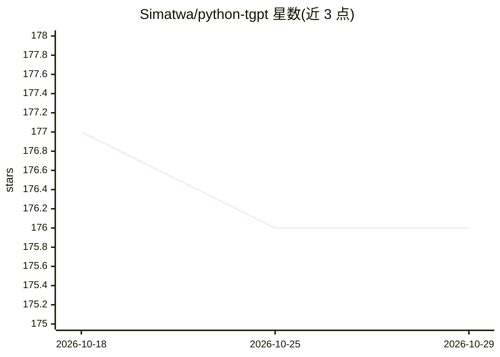

# Simatwa/python-tgpt

⭐ 176 · Python · MIT · 推送 2026-02-21 · [GitHub](https://github.com/Simatwa/python-tgpt) · 个人维护

**无需 API Key 即可对话 45+ 免费 LLM 的 Python 包与 CLI**

tgpt（Golang 版）的 Python 适配：封装 phind、leo、koboldai、opengpt、openai、gpt4free 等来源，提供 Python 包、命令行界面、FastAPI REST-API 与 g4f Web UI 四种使用方式。多数免费 provider 无需 API Key；支持流式/非流式、异步（Async 前缀类）、对话上下文保存加载、图像生成（pollinations.ai/Prodia）、文本转音频、awesome prompts（200+）与 rawdog 模式（按提示生成并执行 Python 代码）。gpt4free 系 provider 多数需要 Google Chrome。

## 筛选速览

| 维度 | 判定 | 备注 |
|---|---|---|
| AI 角色 | `ai-native` | 本体是模型或模型工具 |
| 许可风险 | `permissive` | MIT |
| 部署形态 | `library` | 以包/库形式分发 |
| 模型依赖 | — | README 未给出锁定关系 |
| 硬件要求 | — | 无带数字的原话,不猜 |
| 安装摩擦 | `low` | 无编译、无系统依赖或容器化 |
| 成熟度 | — | 结构信号不足 |

## 能力要点

- 45+ 免费 LLM provider 免 API Key 调用，auto/g4fauto 动态选择可用源
- Python 包 + CLI + FastAPI REST-API + g4f Web UI 多接口
- 图像生成（pollinations.ai/Prodia）与文本转音频
- rawdog 模式按提示生成并执行 Python 代码控制系统
- 管道输入与 {{stream}}/{{copied}} 占位符（如 git diff 生成提交信息）

## 适用场景

- 在终端或脚本中免费调用多种 LLM 生成回答
- 通过 REST API 把免费 LLM 接入自己的服务
- 用 git diff 管道自动生成提交信息
- 文本生成图像与语音播报回答

## 场景标签

`模型网关` `图像生成` · 领域:Agent 开发

## 证据(README 行号)

> L25: This project enables seamless interaction with over **45 free LLM providers** without requiring an API Key and gene
> L32: - 🌐 FastAPI for web integration
> L33: - ⌨️ Command-line interface
> L35: - 🚀 Ready to use (No API key required)

## 星数曲线

2026-10-18 177 → 2026-10-29 176（-1）

---
*卡片 v1 · prompt 1.4 · 生成 2026-10-22 · 置信度 high · 依据 README sha `65df9632f367` · [字段定义](../../DATASET.md)*
