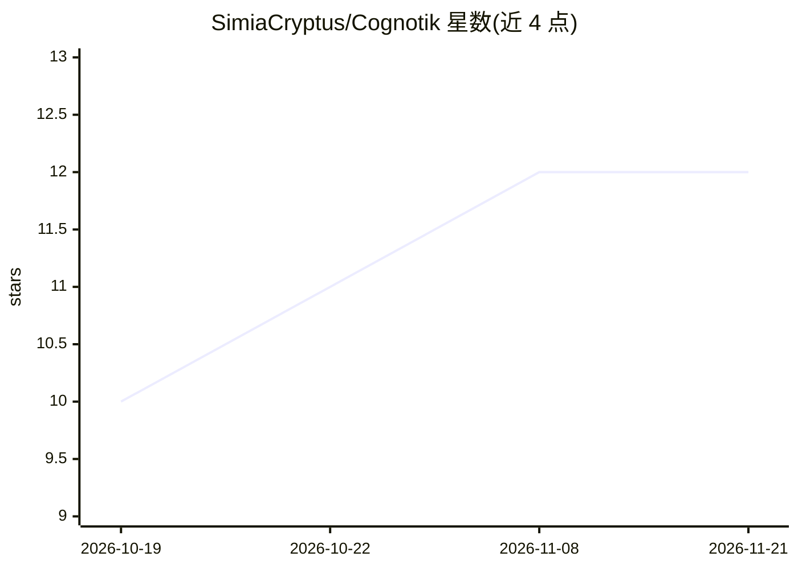

# SimiaCryptus/Cognotik

⭐ 12 · Kotlin · Apache-2.0 · 推送 2026-11-18 · [GitHub](https://github.com/SimiaCryptus/Cognotik) · [官网](https://cognotik.com) · 个人维护

**面向开发者的 JVM 原生 AI 开发平台，覆盖代码生成到文档流水线**

基于 Kotlin 构建的 JVM 原生 AI 开发平台，包含 DocOps 应用套件、规划框架、桌面应用、IntelliJ 插件和独立 Web IDE 等 8 个组件。采用 BYOK 模式，用户自备各服务商 API key；流水线每步以可读文件存储，可入 Git 做版本控制与重放。需 Java 17+，桌面端提供 MSI/DMG/DEB/RPM 安装包，Web IDE 通过启动脚本运行。

## 筛选速览

| 维度 | 判定 | 备注 |
|---|---|---|
| AI 角色 | `ai-ecosystem` | LLM/agent 周边工具 |
| 许可风险 | `permissive` | Apache-2.0 |
| 部署形态 | `library` | 以包/库形式分发 |
| 模型依赖 | local-ok | 支持本地模型 |
| 硬件要求 | — | 无带数字的原话,不猜 |
| 安装摩擦 | `medium` | 含编译或系统依赖之一 |
| 成熟度 | — | 结构信号不足 |

## 能力要点

- 8+ 模型服务商接入，含本地模型（Ollama、LM Studio）
- 文件式流水线状态，每步输入输出可审计、可 Git 追踪
- 桌面、Web、IntelliJ 插件、独立 Web IDE 多种形态
- 声明式 DocProcessor 文档流水线与多认知模式规划框架

## 适用场景

- 用 IntelliJ 插件在 IDE 内完成代码生成、重构与文档撰写
- 本地/远程目录一键启动浏览器版 Web IDE 做开发
- 通过自然语言描述生成并自动修复 Shell 脚本或完整 Web 应用
- 以 BYOK 方式控制模型选择、数据流向与 API 成本

## 场景标签

`代码生成` `编码 Agent` · 领域:编码与开发

## 证据(README 行号)

> L13: Cognotik is a comprehensive, **JVM-native** AI-powered development platform that combines intelligent planning, cod
> L18: Built natively on the JVM in Kotlin, Cognotik runs in your existing Java/Kotlin ecosystem without Python bridges,
> L201: 4. **Model Integration Layer**: JOpenAI provides a unified interface to various AI models and providers.

## 星数曲线

2026-10-19 10 → 2026-11-21 12（+2）

---
*卡片 v1 · prompt 1.4 · 生成 2026-11-18 · 置信度 high · 依据 README sha `88f5a52efb4d` · [字段定义](../../DATASET.md)*
