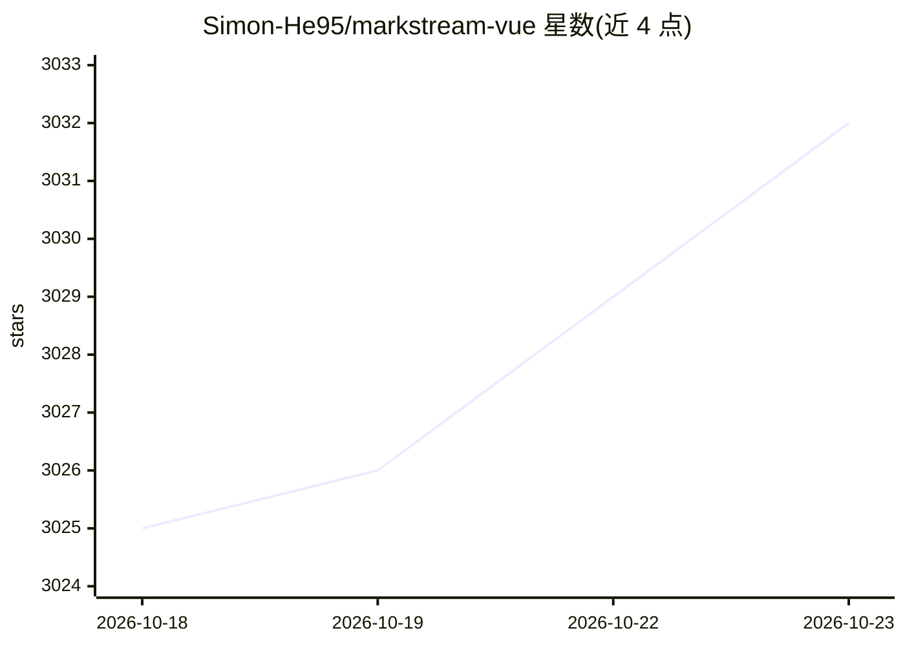

# Simon-He95/markstream-vue

⭐ 3,032 · Vue · MIT · 推送 2026-10-19 · [GitHub](https://github.com/Simon-He95/markstream-vue) · [官网](https://markstream.simonhe.me) · 个人维护 · 中文 README

**多框架流式 Markdown 渲染组件库，服务 AI 聊天界面**

为 Vue 3/Nuxt/VitePress 提供 MarkdownRender 流式 Markdown 渲染组件，面向 AI 聊天、LLM token 流、SSE/WebSocket 输出与未完成的 Markdown 文本；同仓发布 React、Svelte、Angular、Vue 2、Octane 等兄弟包及框架无关的解析器与核心包。支持虚拟窗口与增量批处理两种渲染模式、渐进式 Mermaid 图表、stream-diffs 流式代码块、KaTeX 数学公式与安全 HTML 策略（可设为 escape 转义原始 HTML）。可选依赖仅在需要时安装，2.x 移除了 Monaco 与 stream-markdown 代码块运行时。

## 筛选速览

| 维度 | 判定 | 备注 |
|---|---|---|
| AI 角色 | `ai-ecosystem` | LLM/agent 周边工具 |
| 许可风险 | `permissive` | MIT |
| 部署形态 | `library` | 以包/库形式分发 |
| 模型依赖 | — | README 未给出锁定关系 |
| 硬件要求 | — | 无带数字的原话,不猜 |
| 安装摩擦 | `low` | 无编译、无系统依赖或容器化 |
| 成熟度 | — | 结构信号不足 |

## 能力要点

- 虚拟窗口（长文档）与增量批处理（打字效果）两种渲染模式
- 渐进式 Mermaid 图表与 stream-diffs 流式代码/差异块
- 安全 HTML 策略，非受信内容可将原始 HTML 转义为文本
- 覆盖 Vue/React/Svelte/Angular/Vue2/Octane 六个框架的渲染器家族

## 适用场景

- 我在做 AI 聊天产品，需要稳定渲染流式输出的 Markdown 而不闪烁
- 长 AI 回复场景需要虚拟滚动控制内存
- 在 Nuxt/VitePress 文档站中嵌入流式 Markdown 渲染

## 场景标签

 · 领域:前端/AI 聊天界面组件

## 证据(README 行号)

> L3: `markstream-vue` is a Vue 3 / Nuxt / VitePress streaming Markdown renderer for AI chat, LLM token streams, SSE/WebSo
> L5: Markstream is the renderer family for Vue, React, Octane, Svelte, Angular, and Vue 2. Use sibling packages for non-V
> L116: |build an AI chat UI or SSE stream|AI Chat & Streaming|Performance|

## 星数曲线

2026-10-18 3,025 → 2026-10-23 3,032（+7）

---
*卡片 v1 · prompt 1.4 · 生成 2026-10-20 · 置信度 high · 依据 README sha `5e784d9c309b` · [字段定义](../../DATASET.md)*
