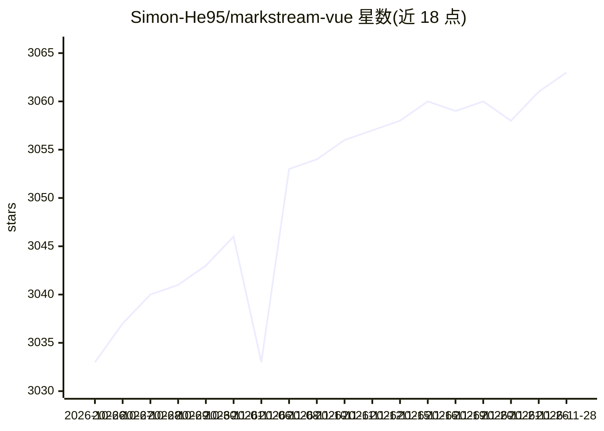

# Simon-He95/markstream-vue

⭐ 3,063 · Vue · MIT · 推送 2026-11-27 · [GitHub](https://github.com/Simon-He95/markstream-vue) · [官网](https://markstream.simonhe.me) · 个人维护 · 中文 README

**为 AI 聊天应用提供流式 Markdown 渲染组件**

面向 Vue/React/SolidJS/Svelte/Angular 等多框架的流式 Markdown 渲染组件库，用于 AI 聊天场景中逐 token 到达的不完整 Markdown 文本渲染，支持 SSE/WebSocket 输入、流式代码块、Mermaid 渐进图表、KaTeX 公式、虚拟滚动长文档、SSR 与安全 HTML 策略。以 npm 包家族形式分发（markstream-vue/react/solid 等），本仓库为 Vue/Nuxt/VitePress 版本，提供各框架在线 playground。

## 筛选速览

| 维度 | 判定 | 备注 |
|---|---|---|
| AI 角色 | `ai-ecosystem` | LLM/agent 周边工具 |
| 许可风险 | `permissive` | MIT |
| 部署形态 | `library` | 以包/库形式分发 |
| 模型依赖 | — | README 未给出锁定关系 |
| 硬件要求 | — | 无带数字的原话,不猜 |
| 安装摩擦 | `low` | 无编译、无系统依赖或容器化 |
| 成熟度 | — | 结构信号不足 |

## 能力要点

- 多框架组件包家族：Vue3/Vue2、React、Octane、SolidJS、Svelte、Angular
- 两种渲染模式：虚拟窗口（长文档）与增量批处理（打字机效果）
- Mermaid 渐进图表、KaTeX、stream-diffs 增强代码块（可选 peer 依赖）
- SSR 导入、安全 HTML 策略（htmlPolicy=escape）与移动端 px 样式

## 适用场景

- 在 AI 聊天 UI 中渲染 LLM 流式返回的不完整 Markdown
- 在 VitePress/文档站点中集成流式内容渲染
- 渲染包含代码 diff、图表与公式的长 AI 回复

## 场景标签

`聊天机器人` · 领域:对话与助手

## 证据(README 行号)

> L1: # Markstream — Streaming Markdown renderers for AI chat
> L3: Markstream is a streaming Markdown renderer family for Vue, React, Octane, SolidJS, Svelte, Angular, and Vue 2, with
> L123: |build an AI chat UI or SSE stream|AI Chat & Streaming|Performance|

## 星数曲线

2026-10-26 3,033 → 2026-11-28 3,063（+30）

---
*卡片 v1 · prompt 1.4 · 生成 2026-11-24 · 置信度 high · 依据 README sha `4b061fb3d17b` · [字段定义](../../DATASET.md)*
