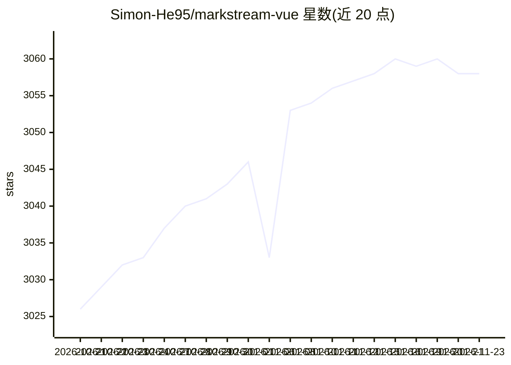

# Simon-He95/markstream-vue

⭐ 3,058 · Vue · MIT · 推送 2026-11-22 · [GitHub](https://github.com/Simon-He95/markstream-vue) · [官网](https://markstream.simonhe.me) · 个人维护 · 中文 README

**为 AI 聊天应用提供的多框架流式 Markdown 渲染组件库**

面向 AI 聊天场景的流式 Markdown 渲染器家族，本仓库为 Vue 3 / Nuxt / VitePress 版本，同系列另有 React、SolidJS、Svelte、Angular、Octane、Vue 2 包。支持 LLM token 流与 SSE/WebSocket 输出下的不完整 Markdown 渲染，提供虚拟窗口与增量批处理两种渲染模式、渐进式 Mermaid 图、KaTeX 数学、流式代码块、SSR 导入、安全 HTML 策略（htmlPolicy="escape"）。通过 npm/pnpm 安装，可选 peer 依赖 stream-diffs、mermaid、katex。

## 筛选速览

| 维度 | 判定 | 备注 |
|---|---|---|
| AI 角色 | `ai-ecosystem` | LLM/agent 周边工具 |
| 许可风险 | `permissive` | MIT |
| 部署形态 | `library` | 以包/库形式分发 |
| 模型依赖 | — | README 未给出锁定关系 |
| 硬件要求 | — | 无带数字的原话,不猜 |
| 安装摩擦 | `low` | 无编译、无系统依赖或容器化 |
| 成熟度 | — | 结构信号不足 |

## 能力要点

- 支持不完整 Markdown 的流式渲染，面向 SSE/WebSocket token 流
- 虚拟窗口与增量批处理两种渲染模式，覆盖长文档与打字效果
- 支持 Mermaid 渐进式图、KaTeX、流式代码块（可选 stream-diffs）
- 提供 SSR 导入（Vite/Nuxt/VitePress）与移动端 WebView 渲染支持

## 适用场景

- 在 Vue/Nuxt 应用中搭建 AI 聊天界面并渲染流式回复
- 在文档站或 VitePress 主题中集成流式 Markdown 渲染
- 渲染含代码 diff、数学公式、图表的长 AI 回复
- 渲染不可信用户内容时启用 HTML 转义策略

## 场景标签

`聊天机器人` · 领域:对话与助手

## 证据(README 行号)

> L1: # Markstream — Streaming Markdown renderers for AI chat
> L3: Markstream is a streaming Markdown renderer family for Vue, React, Octane, SolidJS, Svelte, Angular, and Vue 2, with
> L123: |build an AI chat UI or SSE stream|AI Chat & Streaming|Performance|

## 星数曲线

2026-10-21 3,026 → 2026-11-23 3,058（+32）

---
*卡片 v1 · prompt 1.4 · 生成 2026-11-23 · 置信度 high · 依据 README sha `621d2a235a4d` · [字段定义](../../DATASET.md)*
