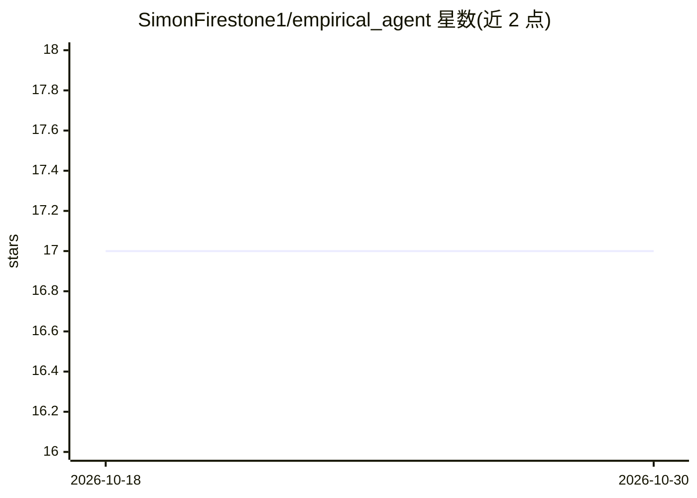

# SimonFirestone1/empirical_agent

⭐ 17 · Python · 推送 2026-09-20 · [GitHub](https://github.com/SimonFirestone1/empirical_agent) · 个人维护

**评测与评分框架：沙箱运行 agentic LLM 并按基准打分**

由两个子项目组成的端到端评测套件：claude-empirical-harness 在隔离沙箱（临时目录、自定义 CLI 包装、禁止数据捷径规则）中执行 agentic 试验，支持确定性自动检查与 LLM-as-Judge 评分；econbench_framework 是 YAML 驱动的评分引擎，将 agent 复现输出与经验证的计量/面板数据基准（含 Wallace AHS 房地产投资基准）对比，生成性能与容差报告。面向需要评估数据科学与计量经济学复制任务中 agent 表现的研究者与开发者，以 Python + Docker 提供，MIT 许可。

## 筛选速览

| 维度 | 判定 | 备注 |
|---|---|---|
| AI 角色 | `ai-ecosystem` | LLM/agent 周边工具 |
| 许可风险 | `permissive` | — |
| 部署形态 | `None` |  |
| 模型依赖 | — | README 未给出锁定关系 |
| 硬件要求 | — | 无带数字的原话,不猜 |
| 安装摩擦 | `low` | 无编译、无系统依赖或容器化 |
| 成熟度 | — | 结构信号不足 |

## 能力要点

- 沙箱化执行：临时目录隔离与自定义 CLI 包装，可配置环境约束
- 自动检查与 LLM-as-Judge 双通道评分
- YAML 驱动的评分引擎：变量、容差、面板时间与权重均可配置
- 内置 Wallace AHS real-options 基准与一次性数据缓存

## 适用场景

- 在受控沙箱中运行 agent 完成计量/数据科学任务并自动评分
- 对比不同条件（环境约束/提示词）下 agent 试验的表现
- 按论文复制基准对 agent 提交的回归结果做定量评分

## 场景标签

`模型评测` · 领域:评测与运维

## 证据(README 行号)

> L3: *An end-to-end framework for running, sandboxing, and scoring agentic LLMs on complex data-science and econometric r
> L15: 1. **`claude-empirical-harness`**: A sandboxed runner that executes agentic trials under strict constraints (such a
> L16: 2. **`econbench_framework`**: A YAML-driven scoring engine that grades agent replication outputs against verified e

## 星数曲线

2026-10-18 17 → 2026-10-30 17（+0）

---
*卡片 v1 · prompt 1.4 · 生成 2026-10-29 · 置信度 high · 依据 README sha `c796117bd9f3` · [字段定义](../../DATASET.md)*
