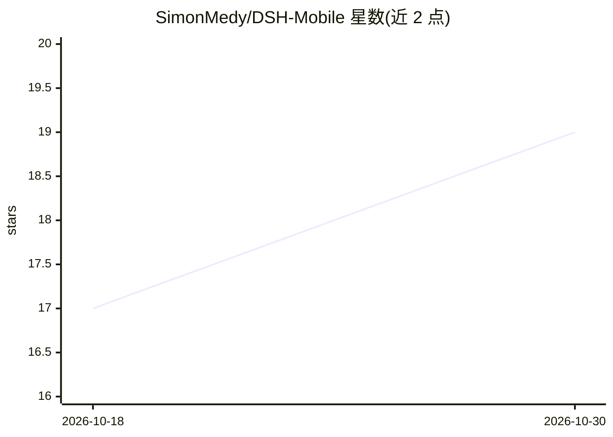

# SimonMedy/DSH-Mobile

⭐ 19 · TypeScript · MIT · 推送 2026-09-01 · [GitHub](https://github.com/SimonMedy/DSH-Mobile) · 个人维护

**DeepSeek Harness Web UI 的非官方移动端 WebView 客户端**

面向 DeepSeek Harness 用户的 React Native 移动客户端：不在手机上运行 Harness，而是连接用户自建的远程 Harness 实例，在隔离的移动 WebView 中显示官方 Web UI，模型、agent 与工具均在主机端执行。提供多服务器管理、连接健康检查、同源隔离导航与本地无凭据持久化。受上游限制，API key 与工作区选择需在主机端 localhost 完成；建议配合 Tailscale 或认证反向代理安全暴露端口。

## 筛选速览

| 维度 | 判定 | 备注 |
|---|---|---|
| AI 角色 | `ai-ecosystem` | LLM/agent 周边工具 |
| 许可风险 | `permissive` | MIT |
| 部署形态 | `self-host` | docker 或自建部署 |
| 模型依赖 | locked-api |  |
| 硬件要求 | — | 无带数字的原话,不猜 |
| 安装摩擦 | `low` | 无编译、无系统依赖或容器化 |
| 成熟度 | — | 结构信号不足 |

## 能力要点

- 连接远程自建 Harness 实例，官方 Web UI 在隔离 WebView 中显示
- 多服务器管理与实时连接健康检查（延迟、最近连接历史）
- 模型、agent、shell 与工作区工具全部在主机端运行，手机零本地开销
- 同源策略导航隔离，外部链接转系统浏览器

## 适用场景

- 在手机上访问自己主机上运行的 DeepSeek Harness 实例
- 管理并快速切换多个 Harness 服务器（家、公司、VPS）
- 通过 Tailscale 安全地从移动设备连接主机 agent 环境

## 场景标签

`AI 助手` · 领域:对话与助手

## 证据(README 行号)

> L10: DSH Mobile does not run Harness on your phone. It connects to user-operated remote DeepSeek Harness instances and d
> L60: - **Zero local overhead:** All AI models, agents, shells, and workspace tools run on your host machine.

## 星数曲线

2026-10-18 17 → 2026-10-30 19（+2）

---
*卡片 v1 · prompt 1.4 · 生成 2026-10-29 · 置信度 high · 依据 README sha `a74b4e78c355` · [字段定义](../../DATASET.md)*
