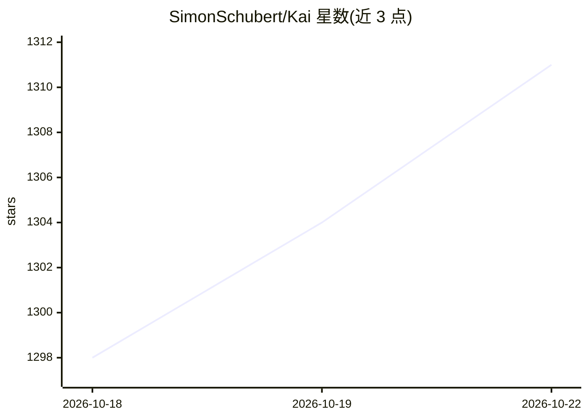

# SimonSchubert/Kai

⭐ 1,314 · Kotlin · Apache-2.0 · 推送 2026-10-21 · [GitHub](https://github.com/SimonSchubert/Kai) · [官网](https://kai9000.com/) · 个人维护

**跨平台开源 AI 助手应用，带持久记忆与设备端推理**

Kotlin 多平台 AI 助手应用，运行于 Android、iOS、Windows、macOS、Linux 与 Web。核心机制：跨对话持久记忆（有用记忆可晋升进系统提示词）、AI 生成交互式界面而非纯文本、30 个 LLM 服务商自动故障切换、Android 上通过 LiteRT 本地推理无需联网、支持 MCP 工具服务器。Android 端内置基于 Alpine/proot 的沙箱 Linux 环境供 AI 执行 shell 命令与脚本，无需 root。提供商店、包管理器与安装包多种分发渠道。

## 筛选速览

| 维度 | 判定 | 备注 |
|---|---|---|
| AI 角色 | `ai-native` | 本体是模型或模型工具 |
| 许可风险 | `permissive` | Apache-2.0 |
| 部署形态 | `None` |  |
| 模型依赖 | local-ok | 支持本地模型 |
| 硬件要求 | — | 无带数字的原话,不猜 |
| 安装摩擦 | `low` | 无编译、无系统依赖或容器化 |
| 成熟度 | — | 结构信号不足 |

## 能力要点

- 跨对话持久记忆并自动调用，可晋升进系统提示词
- 30 个 LLM 服务商多级自动故障切换
- Android 端 LiteRT 设备端本地推理
- Android 内置 proot 沙箱 Linux 环境，AI 可执行命令与脚本
- 支持 MCP 协议连接外部工具服务器

## 适用场景

- 在手机或桌面用一个 AI 助手完成对话、搜索与任务执行
- 在 Android 无网络环境下运行本地模型
- 让 AI 在沙箱里跑脚本和处理数据

## 场景标签

`AI 助手` `聊天机器人` · 领域:对话与助手

## 证据(README 行号)

> L5: An **open-source AI assistant with persistent memory** that runs on **Android, iOS, Windows, Mac, Linux, and Web**.
> L57: - **Persistent memory** — Kai remembers important details across conversations and uses them automatically

## 星数曲线

2026-10-18 1,298 → 2026-10-22 1,311（+13）

---
*卡片 v1 · prompt 1.4 · 生成 2026-10-21 · 置信度 high · 依据 README sha `77281f171ab7` · [字段定义](../../DATASET.md)*
