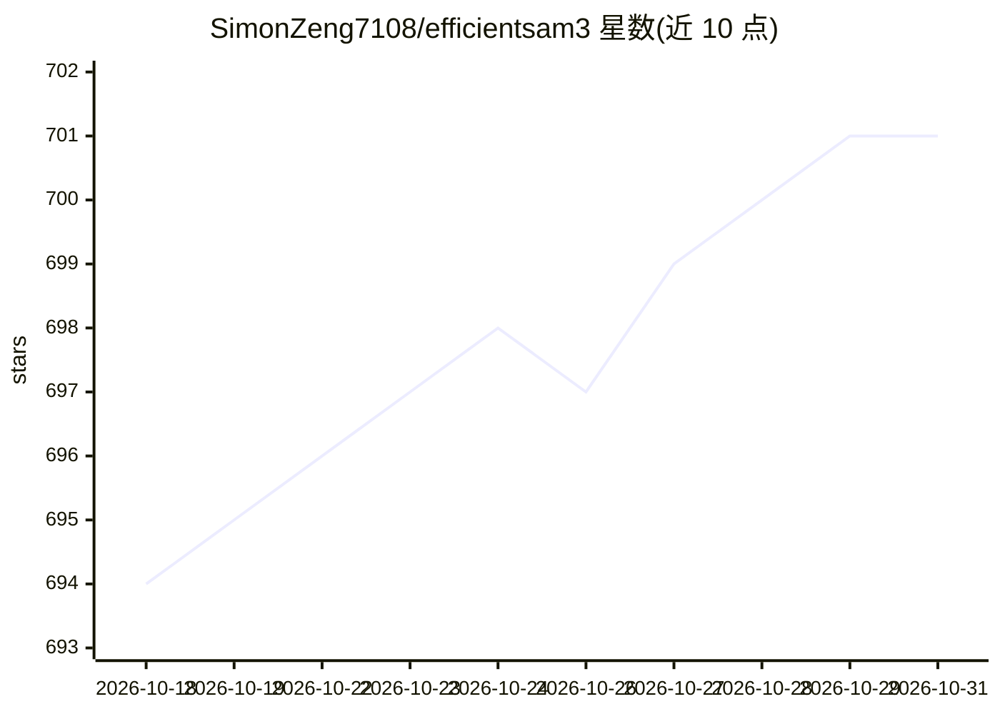

# SimonZeng7108/efficientsam3

⭐ 701 · Jupyter Notebook · 推送 2026-08-11 · [GitHub](https://github.com/SimonZeng7108/efficientsam3) · [官网](https://simonzeng7108.github.io/efficientsam3/) · 组织维护

**将 SAM3 蒸馏为轻量模型，用于边缘端概念分割与跟踪**

面向视觉研究与边缘部署的模型压缩项目：通过从 SAM1/2/3 的渐进式分层知识蒸馏，把 SAM3 的视觉与文本编码器替换为轻量学生模型（EfficientViT/RepViT/TinyViT + MobileCLIP），全量模型约 89-95M 参数（官方标注比 ImageSAM3 小约 89%）。提供权重下载（HuggingFace）、Python 接口、COCO 评估脚本与多数据集下载脚本，支持 ONNX/TensorRT 导出；训练分 Stage 1/2/3，Stage 2 权重尚未发布。要求 Python 3.10+、PyTorch 2.0+，GPU 需 CUDA 11.8+。

## 筛选速览

| 维度 | 判定 | 备注 |
|---|---|---|
| AI 角色 | `ai-native` | 本体是模型或模型工具 |
| 许可风险 | `none` | — |
| 部署形态 | `library` | 以包/库形式分发 |
| 模型依赖 | — | README 未给出锁定关系 |
| 硬件要求 | — | 无带数字的原话,不猜 |
| 安装摩擦 | `medium` | 含编译或系统依赖之一 |
| 成熟度 | — | 结构信号不足 |

## 能力要点

- 渐进式分层蒸馏压缩 SAM3 视觉+文本编码器
- 全量模型 89.2M-95.3M 参数，官方标注比 ImageSAM3 小 89%
- ONNX/TensorRT 导出支持跨平台部署
- 权重发布于 HuggingFace，SAM3-LiteText 被 ICMR2026 接收

## 适用场景

- 在边缘设备上运行可提示的概念分割与跟踪
- 研究知识蒸馏在分割基础模型上的应用
- 在 COCO/DAVIS/SA-V 等数据集上评测轻量分割模型

## 场景标签

`目标检测` · 领域:感知与多模态

## 证据(README 行号)

> L1: # EfficientSAM3: Progressive Hierarchical Knowledge Distillation from SAM1, 2 and 3
> L29: EfficientSAM3 compresses both SAM3's vision encoder and text encoder into lightweight student models while maintain

## 星数曲线

2026-10-18 694 → 2026-10-31 701（+7）

---
*卡片 v1 · prompt 1.4 · 生成 2026-10-21 · 置信度 high · 依据 README sha `a07d14753d2c` · [字段定义](../../DATASET.md)*
