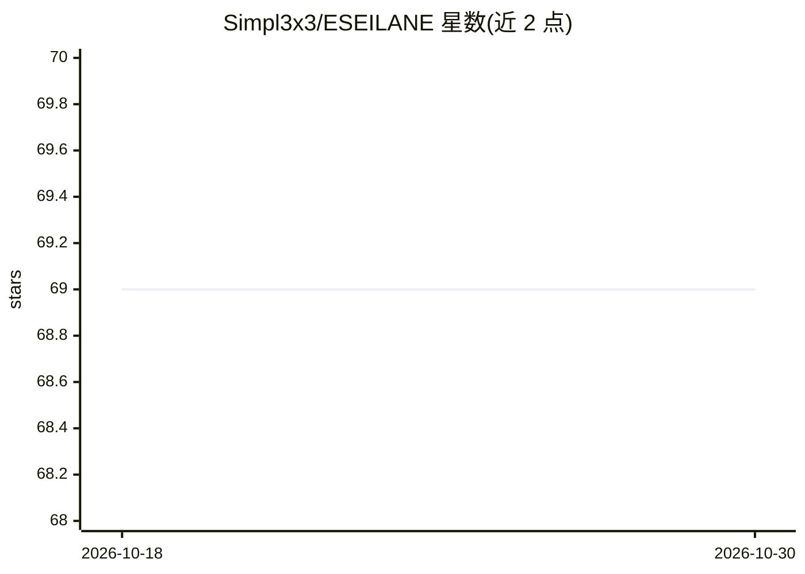

# Simpl3x3/ESEILANE

⭐ 69 · Ruby · NOASSERTION · 推送 2026-06-23 · [GitHub](https://github.com/Simpl3x3/ESEILANE) · [官网](https://eseilane.org) · 个人维护

**面向 LLM 与 GraphRAG 的高性能知识图谱引擎**

用 Rust 编写的知识图谱引擎，基于 GraphBLAS 稀疏矩阵代数执行图遍历与查询，支持属性图模型与 OpenCypher 查询语言，提供 Python 与 TypeScript 客户端库及 Docker 部署方式。面向构建 LLM、GraphRAG 与 AI 应用的开发者：内置 GraphRAGClient 可配置 LLM 提供方构建检索上下文，架构支持水平扩展、多租户、RBAC 与审计日志。README 附有与 Neo4j、ArangoDB 的性能对比表，基准在 AWS r6i.4xlarge 上运行并声明结果随工作负载变化。采用 Apache 2.0 许可。

## 筛选速览

| 维度 | 判定 | 备注 |
|---|---|---|
| AI 角色 | `ai-ecosystem` | LLM/agent 周边工具 |
| 许可风险 | `none` | NOASSERTION |
| 部署形态 | `self-host` | docker 或自建部署 |
| 模型依赖 | — | README 未给出锁定关系 |
| 硬件要求 | — | 无带数字的原话,不猜 |
| 安装摩擦 | `low` | 无编译、无系统依赖或容器化 |
| 成熟度 | — | 结构信号不足 |

## 能力要点

- GraphBLAS 稀疏矩阵代数驱动的图查询执行
- 属性图模型与 OpenCypher 支持
- GraphRAGClient 集成 LLM 提供方构建检索上下文
- 分布式架构、多租户、RBAC 与审计日志

## 适用场景

- 为 GraphRAG 应用提供知识图谱存储与查询后端
- 需要 OpenCypher 接口的高性能图数据服务
- 多租户场景下运行带访问控制的图数据库

## 场景标签

`知识图谱` · 领域:知识与检索

## 证据(README 行号)

> L12:  ESEILANE is a next-generation, high-performance Knowledge Graph engine purpose-built for Large Language Models (LL
> L20: |**GraphRAG Native**|First-class integration with LLMs — reduce hallucinations, improve AI accuracy|
> L74: from eseilane.graphrag import GraphRAGClient

## 星数曲线

2026-10-18 69 → 2026-10-30 69（+0）

---
*卡片 v1 · prompt 1.4 · 生成 2026-10-24 · 置信度 high · 依据 README sha `07214791b046` · [字段定义](../../DATASET.md)*
