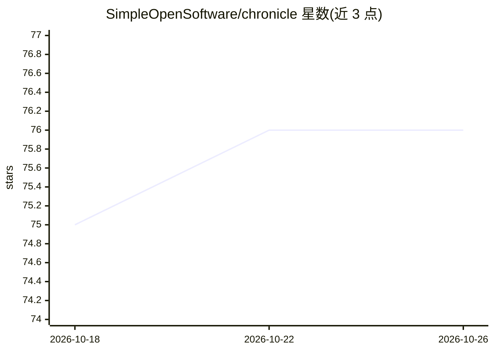

# SimpleOpenSoftware/chronicle

⭐ 76 · Python · MIT · 推送 2026-09-22 · [GitHub](https://github.com/SimpleOpenSoftware/chronicle) · 组织维护

**自托管的个人 AI 记忆系统：从可穿戴设备音频生成记忆与待办**

自托管 AI 系统，通过蓝牙连接 OMI 等可穿戴设备采集音频/视频数据，生成记忆、行动项与关于日常对话的上下文洞察。包含 React Native 移动端应用、后端服务（基础到全 AI 功能分级）、Web 管理面板与桌面菜单栏客户端，可选服务涵盖说话人识别、离线 ASR、唤醒词、TTS 与屏幕采集。通过一条 curl 脚本安装并进入交互式配置向导，提供 ./services 命令管理各服务，支持 Docker/K8s 部署。项目自述面向神经多样性人群的工具场景。

## 筛选速览

| 维度 | 判定 | 备注 |
|---|---|---|
| AI 角色 | `ai-native` | 本体是模型或模型工具 |
| 许可风险 | `permissive` | MIT |
| 部署形态 | `None` |  |
| 模型依赖 | — | README 未给出锁定关系 |
| 硬件要求 | — | 无带数字的原话,不猜 |
| 安装摩擦 | `low` | 无编译、无系统依赖或容器化 |
| 成熟度 | — | 结构信号不足 |

## 能力要点

- 从 OMI 等可穿戴设备采集音频生成记忆、行动项与上下文洞察
- 移动端、后端服务、Web 面板与菜单栏客户端组成完整系统
- 可选服务：说话人识别、离线 ASR、唤醒词、TTS、屏幕采集
- 一键安装脚本进入交互式配置向导，./services 管理服务生命周期

## 适用场景

- 佩戴 OMI 设备记录日常对话并自动生成记忆和待办
- 自托管地管理个人对话与记忆数据，不依赖第三方云
- 扩展到摄像头/智能眼镜实现视觉上下文采集

## 场景标签

`Agent 记忆` `语音识别` · 领域:Agent 开发

## 证据(README 行号)

> L3: Self-hostable AI system that captures audio/video data from OMI devices and other sources to generate memories, acti
> L31: - **Mobile app** for OMI devices via Bluetooth

## 星数曲线

2026-10-18 75 → 2026-10-26 76（+1）

---
*卡片 v1 · prompt 1.4 · 生成 2026-10-24 · 置信度 high · 依据 README sha `85c3772e641c` · [字段定义](../../DATASET.md)*
