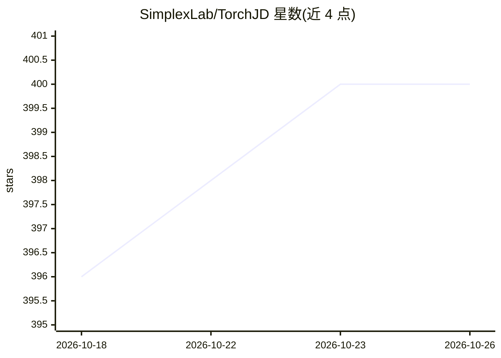

# SimplexLab/TorchJD

⭐ 400 · Python · NOASSERTION · 推送 2026-10-15 · [GitHub](https://github.com/SimplexLab/TorchJD) · [官网](https://torchjd.org) · 组织维护

**PyTorch 多损失训练库：用 Jacobian descent 与标量化优化神经网络**

面向使用 PyTorch 的研究者的多目标/多任务优化库，支持两条路线：将多个损失标量化为单一标量（含 COSMOS、FAMO、DWA 等 12 种 scalarizer），或计算损失对参数的 Jacobian 矩阵并聚合为无冲突更新方向（UPGrad、MGDA、CAGrad、PCGrad 等 20 余种 aggregator）。提供类似 torch.autograd 接口的 autojac 引擎，以及不存储完整 Jacobian、增量计算 Gramian 的 autogram 引擎以适配大模型。库处于 0.x beta 阶段，可能在次版本引入接口变更，破坏性变更附迁移说明。pip 安装，附带论文（arXiv:2406.16232）。

## 筛选速览

| 维度 | 判定 | 备注 |
|---|---|---|
| AI 角色 | `ai-ecosystem` | LLM/agent 周边工具 |
| 许可风险 | `none` | NOASSERTION |
| 部署形态 | `library` | 以包/库形式分发 |
| 模型依赖 | — | README 未给出锁定关系 |
| 硬件要求 | — | 无带数字的原话,不猜 |
| 安装摩擦 | `low` | 无编译、无系统依赖或容器化 |
| 成熟度 | `idea` | |

## 能力要点

- 两条互补路线：标量化（12 种）与 Jacobian descent（20 余种 aggregator）
- autojac 引擎接口类似 torch.autograd，支持 jac/backward/mtl_backward
- autogram 引擎增量计算 Gramian，避免存储完整 Jacobian
- 遵循语义化版本，beta 期破坏性变更附迁移说明

## 适用场景

- 多任务学习中多个损失冲突时的梯度聚合训练
- 多目标优化的 Pareto 前逼近与无冲突更新方向
- 大模型上内存受限时执行 Jacobian descent

## 场景标签

`微调` · 领域:训练与推理

## 证据(README 行号)

> L10: TorchJD is a PyTorch library for training neural networks with **multiple losses**. It supports
> L15: - **Jacobian descent**: compute the Jacobian matrix of losses
> L65: The `torchjd.autojac` engine provides a way to compute

## 星数曲线

2026-10-18 396 → 2026-10-26 400（+4）

---
*卡片 v1 · prompt 1.4 · 生成 2026-10-21 · 置信度 high · 依据 README sha `11a2a2aa0467` · [字段定义](../../DATASET.md)*
