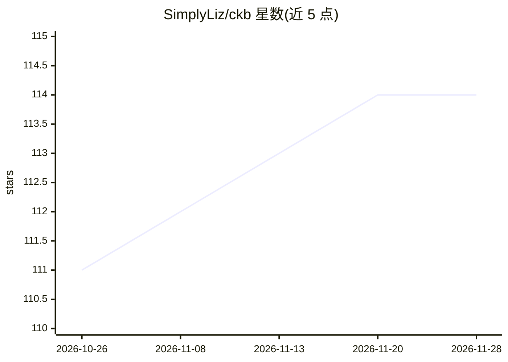

# SimplyLiz/ckb

⭐ 114 · Go · NOASSERTION · 推送 2026-11-24 · [GitHub](https://github.com/SimplyLiz/ckb) · [官网](https://github.com/SimplyLiz/CodeMCP/wiki) · 组织维护

**面向 AI 编程助手与开发者的代码知识查询后端**

CKB 将代码库转换为可查询的知识库，通过 MCP、CLI 和 HTTP API 三种接口提供语义搜索、调用图、影响分析、风险评分、死代码检测、密钥扫描、所有权查询与架构映射等功能。底层依赖 SCIP 索引，无索引时以 tree-sitter 解析降级运行；语言支持分四档，Go 为完全支持档并支持增量索引。提供 npm/Homebrew/源码安装，可一键接入 Claude Code 等 AI 编程工具，PR 审查模式无需 LLM 调用即可输出 SARIF 结果。

## 筛选速览

| 维度 | 判定 | 备注 |
|---|---|---|
| AI 角色 | `ai-ecosystem` | LLM/agent 周边工具 |
| 许可风险 | `none` | NOASSERTION |
| 部署形态 | `library` | 以包/库形式分发 |
| 模型依赖 | — | README 未给出锁定关系 |
| 硬件要求 | — | 无带数字的原话,不猜 |
| 安装摩擦 | `low` | 无编译、无系统依赖或容器化 |
| 成熟度 | — | 结构信号不足 |

## 能力要点

- 基于 SCIP 索引的语义导航、影响分析与调用图
- explore/understand/prepareChange 单调用复合工具以减少 AI 工具调用次数
- PR 审查运行 21 项检查且零 token、零 API 调用
- 工具预设按需加载以降低上下文占用，支持 SSE 流式输出

## 适用场景

- 在 Claude Code/Cursor 中通过 MCP 查询代码影响范围与调用关系
- CI 中无需 LLM 运行 PR 质量审查并输出 SARIF 报告
- 定位死代码、密钥泄露与技术债务热点
- 为自研 IDE 插件或脚本提供 HTTP API 代码智能后端

## 场景标签

`语义搜索` · 领域:知识与检索

## 证据(README 行号)

> L12: CKB transforms your codebase into a queryable knowledge base. Ask questions, understand impact, find owners, detect
> L44: 🔗 **Integrate** — CLI, HTTP API, MCP for AI tools, CI/CD pipelines, custom scripts
> L170: |**MCP**|AI-assisted development — Claude, Cursor, Windsurf, VS Code, OpenCode, Grok, Codex|

## 星数曲线

2026-10-26 111 → 2026-11-28 114（+3）

---
*卡片 v1 · prompt 1.4 · 生成 2026-11-28 · 置信度 high · 依据 README sha `0f189a3fe3b1` · [字段定义](../../DATASET.md)*
