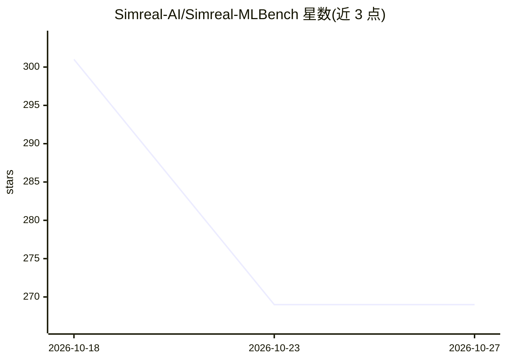

# Simreal-AI/Simreal-MLBench

⭐ 269 · Python · Apache-2.0 · 推送 2026-09-24 · [GitHub](https://github.com/Simreal-AI/Simreal-MLBench) · [官网](https://simreal.co) · 组织维护

**面向 ML 研究 agent 的外部打分评测基准（60 任务，双层开放）**

Simreal 公司运营的机器学习研究 agent 评测基准：60 个任务覆盖表格、预测、视觉、语言、音频、多模态与科学结构化数据，源自真实竞赛并采用冻结的官方排行榜作为 ground truth。分两层发布：任务目录、评测协议、打分与校验代码、mleb-remote SDK 以 Apache-2.0 公开，可本地复算每个分数；评测运行时（网关、worker、官方打分路由）是 Simreal 运营的商业服务，lab/团队通过联系商务接入而非自托管。任务评分公式为 100×p²，agent 至多两次官方提交。仓库状态为 public preview，官方基准线仅 3 个任务端到端验证，完整榜单为计划中。

## 筛选速览

| 维度 | 判定 | 备注 |
|---|---|---|
| AI 角色 | `ai-ecosystem` | LLM/agent 周边工具 |
| 许可风险 | `permissive` | Apache-2.0 |
| 部署形态 | `library` | 以包/库形式分发 |
| 模型依赖 | — | README 未给出锁定关系 |
| 硬件要求 | — | 无带数字的原话,不猜 |
| 安装摩擦 | `low` | 无编译、无系统依赖或容器化 |
| 成熟度 | `idea` | |

## 能力要点

- 60 任务目录与评测协议、打分代码以 Apache-2.0 公开，可复算已发布分数
- 评分采用外部竞赛平台标签与冻结参考排行榜，提交记录含提交 id 与工件哈希的完整溯源
- 两次官方提交机制与任务简报的 source-blind 检查
- 评分前用对抗性提交探测奖励函数

## 适用场景

- 评测我的 ML 研究 agent 在完整研究流程上的表现
- 本地校验任务目录并复算公开分数
- 通过 Simreal 运营服务获得带完整溯源的官方评测结果

## 场景标签

`模型评测` · 领域:评测与运维

## 证据(README 行号)

> L5: **An externally scored, verifiable evaluation environment for machine learning research agents.**
> L12: An agent studies a dataset, develops a modeling approach, runs experiments, and submits predictions. ML Benchmark b
> L28: **The operated layer is the service.** The evaluation runtime is a commercial product operated by Simreal. It runs 

## 星数曲线

2026-10-18 301 → 2026-10-27 269（-32）

---
*卡片 v1 · prompt 1.4 · 生成 2026-10-21 · 置信度 mid · 依据 README sha `945c789b2cf0` · [字段定义](../../DATASET.md)*
