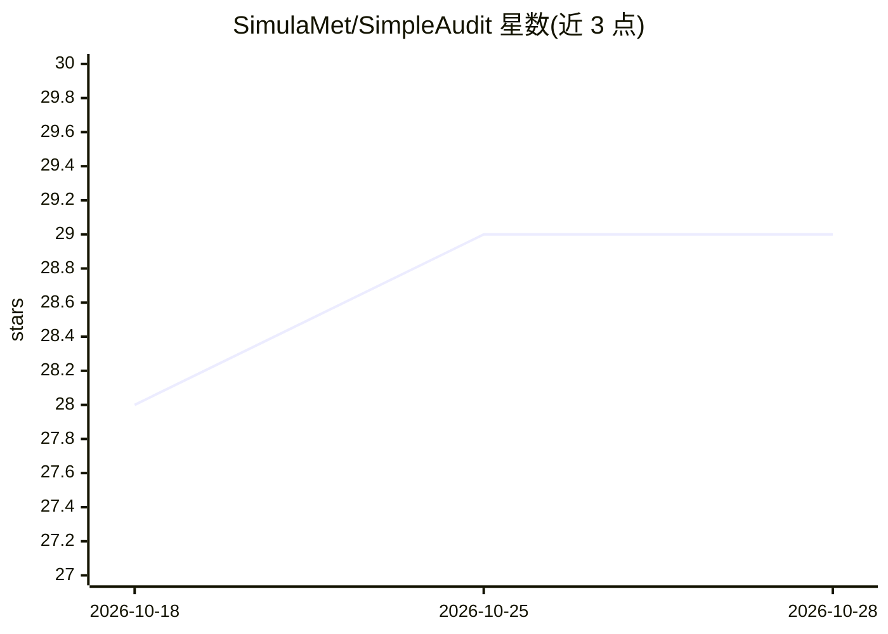

# SimulaMet/SimpleAudit

⭐ 29 · Python · MIT · 推送 2026-10-24 · [GitHub](https://github.com/SimulaMet/SimpleAudit) · 组织维护

**本地优先的多语言 AI 安全审计与红队测试框架**

由 Simula/SimulaMet 与挪威卫生署合作开发的 AI 安全审计框架，通过对抗性探测场景对 AI 系统做多语言审计与红队测试，默认支持本地运行的开源模型（无需 API），也可选评估 API 托管模型。提供 LLM 法官裁决、重复运行稳定性分析（熵/一致性阈值）、adaptive_reruns 预算重跑、judge 鲁棒性检查（提示词变体、法官交换、转录扰动）与 rejudge 复评等机制，配套 SimpleAudit Studio 网页界面。以 pip 包发布，要求 Python 3.11+。

## 筛选速览

| 维度 | 判定 | 备注 |
|---|---|---|
| AI 角色 | `ai-ecosystem` | LLM/agent 周边工具 |
| 许可风险 | `permissive` | MIT |
| 部署形态 | `library` | 以包/库形式分发 |
| 模型依赖 | local-ok | 支持本地模型 |
| 硬件要求 | — | 无带数字的原话,不猜 |
| 安装摩擦 | `low` | 无编译、无系统依赖或容器化 |
| 成熟度 | — | 结构信号不足 |

## 能力要点

- 对抗性探测场景审计与红队测试，本地优先、默认不收集用户数据
- 稳定性分析：归一化熵、一致率、脆弱场景标记（阈值 60%）
- judge 鲁棒性检查：reframing、法官交换、转录扰动（道歉/免责/权威声明等 5 种）、rejudge 复评
- SimpleAudit Studio 网页 UI 用于构建场景、运行审计与结果对比

## 适用场景

- 对自研或第三方 AI 系统做安全红队测试
- 同一场景包跨多个模型运行对比审计结果
- 核验 LLM 法官裁决的稳定性，识别脆弱结论

## 场景标签

`网络安全` · 领域:学习与行业

## 证据(README 行号)

> L13: SimpleAudit is a simple, extensible, local-first framework for multilingual auditing and red-teaming of AI systems 
> L66: Run the same scenario pack across multiple models and compare results.

## 星数曲线

2026-10-18 28 → 2026-10-28 29（+1）

---
*卡片 v1 · prompt 1.4 · 生成 2026-10-26 · 置信度 high · 依据 README sha `71648bc7fa0b` · [字段定义](../../DATASET.md)*
