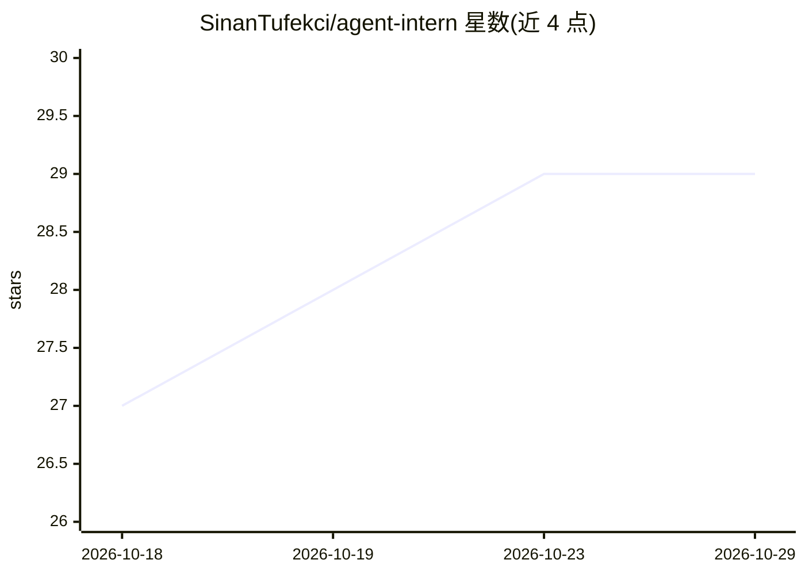

# SinanTufekci/agent-intern

⭐ 29 · Python · MIT · 推送 2026-10-15 · [GitHub](https://github.com/SinanTufekci/agent-intern) · 个人维护

**把 Gemini/Codex/Copilot 等 CLI 变成 Claude Code 子代理的 MCP 服务器**

面向已订阅多种 AI 编程工具的开发者的 MCP 服务器：将 Antigravity(Gemini)、Codex、Copilot、Cursor、opencode 等官方 CLI 以 headless 方式作为 Claude Code 可调用的工具运行，复用用户已有登录与配额，自身不管理任何密钥。提供文本问答、Gemini 图像生成、跨后端并行 swarm 与预置评审面板（jury/research/red-team/council），共 29 个工具。Grok/Kimi/Muse 后端为实验性且真实模型回复未经验证。安全上多数后端无 OS 沙箱，文档建议在容器或 VM 中运行以获得隔离。

## 筛选速览

| 维度 | 判定 | 备注 |
|---|---|---|
| AI 角色 | `ai-ecosystem` | LLM/agent 周边工具 |
| 许可风险 | `permissive` | MIT |
| 部署形态 | `library` | 以包/库形式分发 |
| 模型依赖 | locked-api |  |
| 硬件要求 | — | 无带数字的原话,不猜 |
| 安装摩擦 | `low` | 无编译、无系统依赖或容器化 |
| 成熟度 | `idea` | |

## 能力要点

- MCP 桥接 8 个编码 CLI，无私有 API、无 token 处理
- agent_swarm 并行分发任务并可混用后端
- antigravity_image 经 Gemini 生成图像并保存文件
- preset_swarm 一键运行评审团/红队/研究面板

## 适用场景

- 让其他模型家族审查 Claude 刚写的代码，获取第二意见
- 批量机械性改动消耗其他订阅配额而非 Claude 配额
- 在 Claude Code 内直接生成图像
- 多后端并行评审同一材料并汇总分歧

## 场景标签

`多智能体` `代码审查` `图像生成` · 领域:Agent 开发

## 证据(README 行号)

> L22: **agent-intern** is an MCP server that turns those CLIs into tools Claude Code can call. Claude stays in
> L166:     CC -- "MCP tool call" --> B["agent-intern (MCP server)"]

## 星数曲线

2026-10-18 27 → 2026-10-29 29（+2）

---
*卡片 v1 · prompt 1.4 · 生成 2026-10-26 · 置信度 mid · 依据 README sha `ff7194f9c87d` · [字段定义](../../DATASET.md)*
