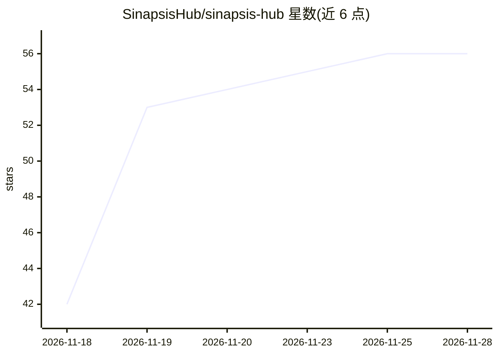

# SinapsisHub/sinapsis-hub

⭐ 56 · Python · Apache-2.0 · 推送 2026-11-27 · [GitHub](https://github.com/SinapsisHub/sinapsis-hub) · [官网](https://sinapsis.tech/) · 组织维护

**统一契约组装 AI 系统的开源框架：模板组合模型与框架**

Sinapsis 是一个用统一计算契约组装 AI 系统的 Python 框架：能力封装为 Template（运行模型、调用 API、训练、处理图像、查数据库等），Template 组合成 Agent，开发与执行分离，支持本地、多进程、远程或分布式执行。生态含 100+ 独立包（anthropic、doctr、ultralytics、langchain 等），按需安装、各自维护依赖。同一 Agent 模型可通过 Python、CLI、UI、VS Code 与 API 使用。Sinapsis UI 标注 coming soon，另有商业化的 Sinapsis Cloud 托管能力。需 Python 3.10+。

## 筛选速览

| 维度 | 判定 | 备注 |
|---|---|---|
| AI 角色 | `ai-ecosystem` | LLM/agent 周边工具 |
| 许可风险 | `permissive` | Apache-2.0 |
| 部署形态 | `library` | 以包/库形式分发 |
| 模型依赖 | — | README 未给出锁定关系 |
| 硬件要求 | — | 无带数字的原话,不猜 |
| 安装摩擦 | `low` | 无编译、无系统依赖或容器化 |
| 成熟度 | — | 结构信号不足 |

## 能力要点

- Template→Agent 的可复用组件组合模型
- 计算与执行分离：本地/并发/远程/分布式同一套定义
- 100+ 独立安装的生态包，依赖栈互不强制统一
- 同一 Agent 模型经 Python、CLI、UI、VS Code、API 访问

## 适用场景

- 把模型、API 与自定义代码组合成生产级 AI 应用而不绑定单一运行时
- 复用已建能力跨项目组装更大系统
- 本地开发后切换到分布式或云端托管执行

## 场景标签

`Agent 框架` · 领域:Agent 开发

## 证据(README 行号)

> L14: Compose and build AI systems from reusable components. Combine models, frameworks, APIs, data, and custom code thro
> L95: Sinapsis brings different technologies together through a common computational contract, reducing the need to repea
> L126: Templates compose into **Agents** — computational systems that combine different technologies through a common int

## 星数曲线

2026-11-18 42 → 2026-11-28 56（+14）

---
*卡片 v1 · prompt 1.4 · 生成 2026-11-18 · 置信度 high · 依据 README sha `b23b551a60e0` · [字段定义](../../DATASET.md)*
