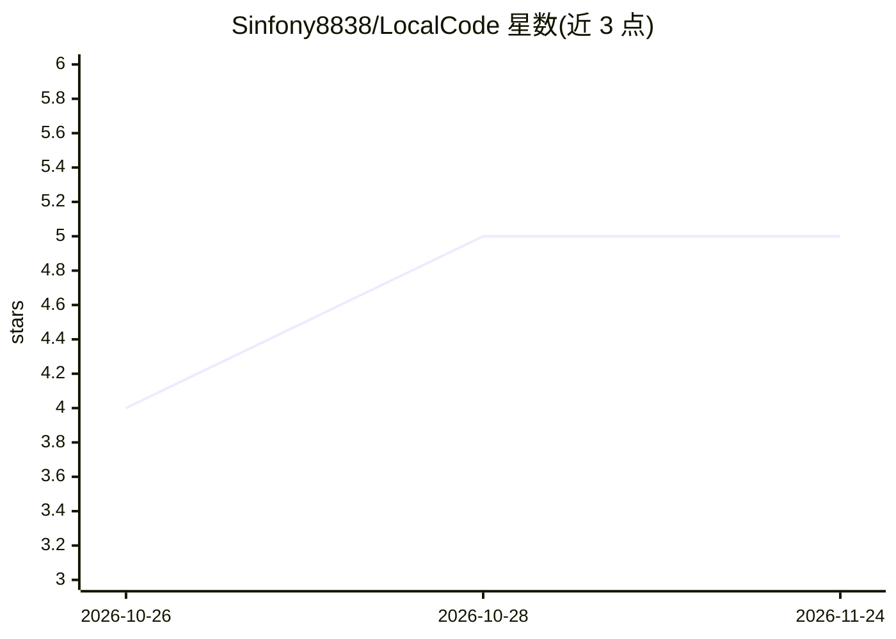

# Sinfony8838/LocalCode

⭐ 5 · TypeScript · MIT · 推送 2026-11-23 · [GitHub](https://github.com/Sinfony8838/LocalCode) · 个人维护 · 中文 README

**Windows 本地优先 AI 编程桌面，Ollama 本地推理与隔离 Agent**

面向 Windows 的 Electron + React + TypeScript 编程桌面应用：每个会话运行独立的 agent worker，本地通过 Ollama 推理，可读取/编辑项目文件、审查变更、审批终端命令并恢复历史会话。支持简体中文/英/日/韩界面，提供三种审批模式（询问/规则/完全访问），本地模型每回合限 12 次工具调用。分发方式为 x64 portable ZIP 解压运行或源码 Setup.cmd 构建；可选 Install-LocalModel.cmd 下载校验固定的 Ollama 0.40.10 与 qwen3.5:9b 模型（建议 25 GiB 磁盘）。无项目文件夹的任务不含文件写入与终端工具；各审批模式均非 OS 沙箱。

## 筛选速览

| 维度 | 判定 | 备注 |
|---|---|---|
| AI 角色 | `ai-native` | 本体是模型或模型工具 |
| 许可风险 | `permissive` | MIT |
| 部署形态 | `desktop` | 安装包/桌面程序 |
| 模型依赖 | local-ok | 支持本地模型 |
| 硬件要求 | `gpu-24g` | |
| 安装摩擦 | `low` | 无编译、无系统依赖或容器化 |
| 成熟度 | — | 结构信号不足 |

## 能力要点

- 每会话独立 agent worker，Ollama 本地推理或自定义 OpenAI/Anthropic 兼容 API
- 三种审批模式，命令审批绑定具体命令与工作目录
- Install-LocalModel.cmd 一键安装校验固定的 Ollama 与 qwen3.5:9b 本地模型
- 四语言界面（简中/英/日/韩）与会话存档/恢复

## 适用场景

- 在 Windows 本机运行不依赖云端的编程助手
- 对终端命令执行需要逐条审批控制的工作流
- 已有 Ollama 服务并希望桌面端接入已有本地模型
- 通过火山 Coding Plan 等自定义 API 接入云模型

## 场景标签

`编码 Agent` `AI 助手` · 领域:编码与开发

## 证据(README 行号)

> L9: A local-first coding desktop for Windows: Electron + React + TypeScript, a separate agent worker for each conversati
> L70:  - **Want LocalCode's managed local model?** Close LocalCode, then double-click **`Install-LocalModel.cmd`**. This 
> L35: An approval card can allow once, allow the same scope for this conversation, or deny. Command approvals are bound t

## 星数曲线

2026-10-26 4 → 2026-11-24 5（+1）

---
*卡片 v1 · prompt 1.4 · 生成 2026-11-21 · 置信度 high · 依据 README sha `13b1d6712c06` · [字段定义](../../DATASET.md)*
