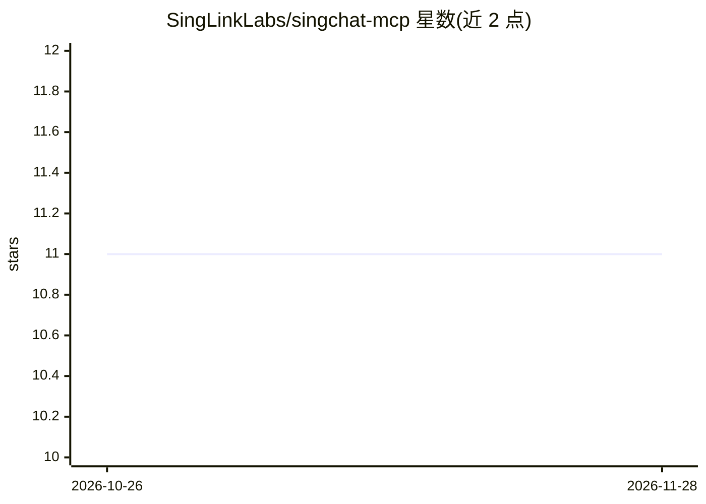

# SingLinkLabs/singchat-mcp

⭐ 11 · MIT · 推送 2026-07-16 · [GitHub](https://github.com/SingLinkLabs/singchat-mcp) · [官网](https://mcp.singchat.org) · 组织维护

**给开发者的网站免费在线客服+AI 支持代理，经 MCP 接入管理**

SingChat MCP 是托管客服平台 SingChat 的 MCP 服务器入口（HTTPS 端点），仓库本身只含清单、示例与文档。用户从 Claude Code、Cursor、ChatGPT、Grok、Gemini CLI 等 MCP 客户端添加该端点后，助手获得 17 个工具：创建免费工作区（免注册，直接返回登录凭据与嵌入代码）、读取/回复/关闭访客对话、通过网站爬取与 Q&A 对训练 AI 客服代理（RAG）、配置模型与关键词自动回复、管理 FAQ、读取统计。平台托管，无需自部署，支持多平台 SDK 与 13 种语言。

## 筛选速览

| 维度 | 判定 | 备注 |
|---|---|---|
| AI 角色 | `ai-ecosystem` | LLM/agent 周边工具 |
| 许可风险 | `permissive` | MIT |
| 部署形态 | `library` | 以包/库形式分发 |
| 模型依赖 | — | README 未给出锁定关系 |
| 硬件要求 | — | 无带数字的原话,不猜 |
| 安装摩擦 | `low` | 无编译、无系统依赖或容器化 |
| 成熟度 | — | 结构信号不足 |

## 能力要点

- 一条命令即可创建免费工作区，返回登录凭据、嵌入代码与 API key（免注册）
- 17 个 MCP 工具覆盖对话管理、AI 训练（RAG）、代理配置与分析
- 支持网站爬取+Q&A 训练、关键词规则与人工接管
- 提供 Web/iOS/Android/React Native/Flutter SDK 及 Telegram/WhatsApp 渠道

## 适用场景

- 给自己的网站快速加一个在线客服窗口
- 用 AI 代理自动回答访客问题，必要时转人工
- 在编辑器或聊天应用里直接查看和回复客户会话

## 场景标签

`聊天机器人` · 领域:对话与助手

## 证据(README 行号)

> L10: **Endpoint:** `https://mcp.singchat.org`
> L12: SingChat MCP lets any MCP-capable AI assistant create a free SingChat workspace, drop a live-chat widget on your we
> L82: Once connected, your assistant gets 17 tools. Every tool acts only on the workspace bound to your API key, no tenan

## 星数曲线

2026-10-26 11 → 2026-11-28 11（+0）

---
*卡片 v1 · prompt 1.4 · 生成 2026-11-18 · 置信度 high · 依据 README sha `43355c7c01bf` · [字段定义](../../DATASET.md)*
