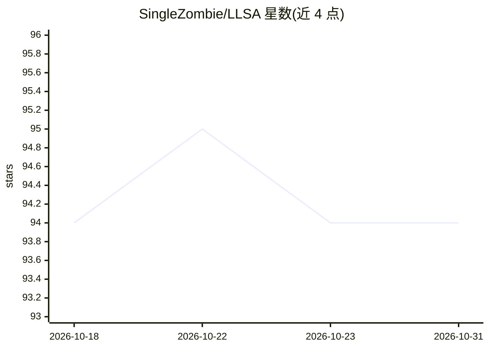

# SingleZombie/LLSA

⭐ 94 · Python · NOASSERTION · 推送 2026-05-01 · [GitHub](https://github.com/SingleZombie/LLSA) · 组织维护

**CVPR 2026 论文 LLSA 官方实现：log-linear 稀疏注意力算子**

Log-linear Sparse Attention 的官方 PyTorch 实现，提供 Triton/torch 算子，可将标准 scaled dot-product attention 替换为 LLSA（按序列长度选 L1/L2 两级），支持变长序列，面向需要降低长序列注意力开销的深度学习开发者。附带纯像素 DiT（无 VAE、无 patchify）训练示例与 FID 评估脚本。当前限制：仅支持非因果注意力，token 长度与 topk 须为 2 的幂。通过 git clone + pip install -e 源码安装。

## 筛选速览

| 维度 | 判定 | 备注 |
|---|---|---|
| AI 角色 | `ai-ecosystem` | LLM/agent 周边工具 |
| 许可风险 | `none` | NOASSERTION |
| 部署形态 | `library` | 以包/库形式分发 |
| 模型依赖 | — | README 未给出锁定关系 |
| 硬件要求 | — | 无带数字的原话,不猜 |
| 安装摩擦 | `low` | 无编译、无系统依赖或容器化 |
| 成熟度 | — | 结构信号不足 |

## 能力要点

- 以单行调用替换标准 SDPA 的 LLSA 算子（L1/L2 按序列长度分级）
- 支持变长序列
- 纯像素 DiT 训练示例（FFHQ-32/128）与 FID 评估脚本

## 适用场景

- 长序列 Transformer 中替换全量注意力以降低开销
- 复现论文的纯像素 DiT 生成实验
- 在图像/视频等非序列数据上做 token 重排后使用稀疏注意力

## 场景标签

`模型训练` · 领域:训练与推理

## 证据(README 行号)

> L15: Official PyTorch implementation of Log-linear Sparse Attention (LLSA)
> L53: + attn_output = llsa_l1(query, key, value, block_size=16)

## 星数曲线

2026-10-18 94 → 2026-10-31 94（+0）

---
*卡片 v1 · prompt 1.4 · 生成 2026-10-23 · 置信度 mid · 依据 README sha `72d69c9a17ab` · [字段定义](../../DATASET.md)*
