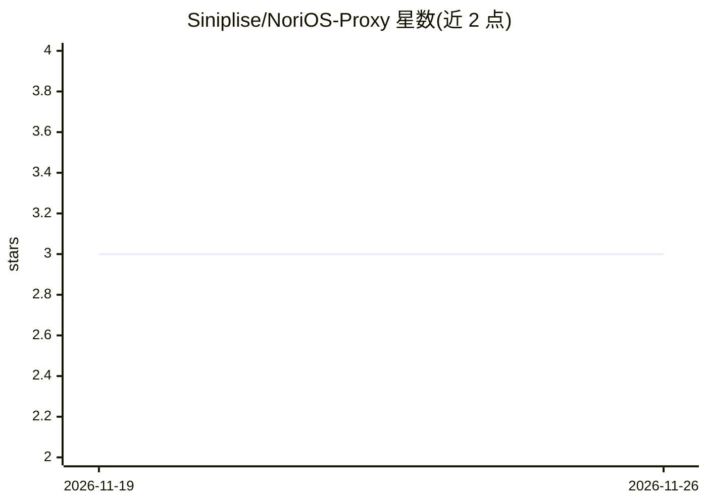

# Siniplise/NoriOS-Proxy

⭐ 3 · JavaScript · MIT · 推送 2026-10-31 · [GitHub](https://github.com/Siniplise/NoriOS-Proxy) · 个人维护 · 中文 README

**为 Nori.Web 游戏加记忆、剧情与 TTS 语音的本地反向代理**

部署在游戏前端与人格/TTS 服务之间的本地中间层：双向透传 WebSocket，注入客户端脚本，把固定台词角色接入 LLM 人格记忆、剧情 beat 触发与流式 TTS 语音。提供 exe 补丁工具、注入脚本安装、环境变量配置、记忆重置与会话录制脚本。依赖 Node.js ≥20、外部 Nori.Web 发行包、DeepSeek 与 Inworld API Key；不支持上游新版本，仅锁定 commit cf77e75。

## 筛选速览

| 维度 | 判定 | 备注 |
|---|---|---|
| AI 角色 | `ai-native` | 本体是模型或模型工具 |
| 许可风险 | `permissive` | MIT |
| 部署形态 | `desktop` | 安装包/桌面程序 |
| 模型依赖 | locked-api |  |
| 硬件要求 | — | 无带数字的原话,不猜 |
| 安装摩擦 | `low` | 无编译、无系统依赖或容器化 |
| 成熟度 | — | 结构信号不足 |

## 能力要点

- 双向透传 WebSocket，文本帧不重序列化、音频帧原样转发
- 14 条剧情 beat 按游戏事实触发，语音队列逐句回报并有 9s 兜底
- 工具链含 exe 补丁、旁路录制、记忆重置与进程守护脚本
- 密钥全部从环境变量读取

## 适用场景

- 让 Nori.Web 角色记住跨局对话并持续有语音
- 在不改动游戏前端的前提下替换剧情与语音逻辑
- 本地录制并留档游戏会话

## 场景标签

`语音合成` · 领域:内容生成

## 证据(README 行号)

> L7: Nori.Web 的本地中间层：在游戏前端与人格 / TTS 服务之间做反向代理，并注入客户端脚本，
> L27: |DeepSeek API Key|—|是|后端 LLM（人格服务使用）|

## 星数曲线

2026-11-19 3 → 2026-11-26 3（+0）

---
*卡片 v1 · prompt 1.4 · 生成 2026-11-22 · 置信度 high · 依据 README sha `d04fa451508d` · [字段定义](../../DATASET.md)*
