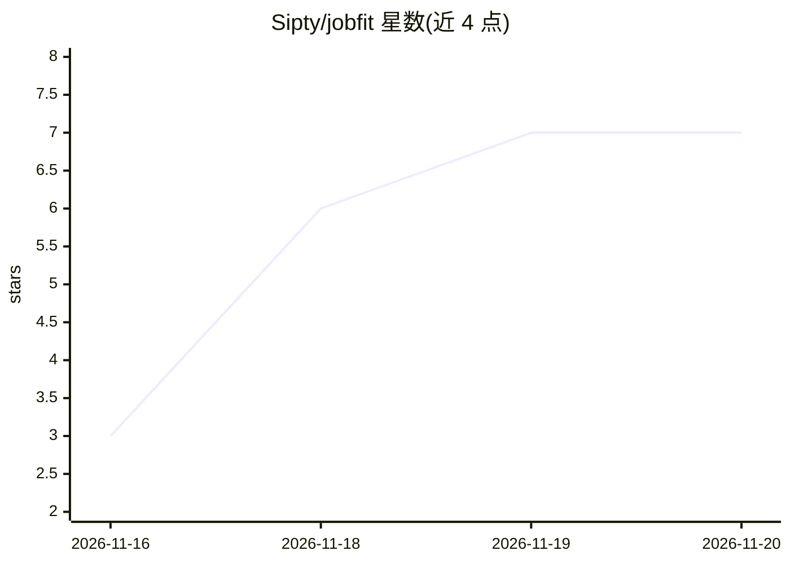

# Sipty/jobfit

⭐ 7 · Python · MIT · 推送 2026-11-15 · [GitHub](https://github.com/Sipty/jobfit) · [官网](https://exitnode.dev/get-jobfit/) · 个人维护

**求职者用 LLM 匹配职位并生成定制简历 PDF 的 CLI**

命令行工具：将职位列表与 JSON 格式 CV 匹配，调用任意可通过 shell 命令访问的 LLM 打分排序，输出排名报告 PDF 及为达阈值职位生成的定制简历 PDF。匹配、定制与渲染由确定性代码完成，定制步骤有校验守卫防止编造雇主、日期、教育或姓名。已推荐过的职位记录在 memory 中不再重复推荐。需 Python 3.11+ 与 uv，WeasyPrint 渲染依赖 Pango/GLib 系统库。可从任意能运行 shell 命令的 agent harness 使用。

## 筛选速览

| 维度 | 判定 | 备注 |
|---|---|---|
| AI 角色 | `ai-native` | 本体是模型或模型工具 |
| 许可风险 | `permissive` | MIT |
| 部署形态 | `None` |  |
| 模型依赖 | local-ok | 支持本地模型 |
| 硬件要求 | — | 无带数字的原话,不猜 |
| 安装摩擦 | `low` | 无编译、无系统依赖或容器化 |
| 成熟度 | — | 结构信号不足 |

## 能力要点

- 通过 shell 命令调用任意 LLM，不依赖 SDK，支持 Claude Code/Codex CLI/Gemini CLI/Ollama 等 harness
- 定制简历带校验守卫：机械拒绝改动雇主、日期、教育与联系姓名的输出
- 已推荐职位存入 .jobfit/memory.json 去重，忽略词序、标点与小拼写错误
- 支持从公开 Greenhouse 和 Lever 招聘板收集职位

## 适用场景

- 批量对比职位与自己的 CV，得到带评分理由的排名报告
- 为值得投递的职位自动生成按该职位措辞优化的定制简历
- 让 agent harness 自动完成收集职位、匹配与生成简历的流程

## 场景标签

`AI 写作` · 领域:内容生成

## 证据(README 行号)

> L3: Match job openings against your CV, rank them with any LLM, and get a ranked report PDF plus a tailored CV PDF per w
> L8: The LLM is reached through a shell command, never an SDK.
> L9: The tailoring step cannot invent employers, dates, education or your name.

## 星数曲线

2026-11-16 3 → 2026-11-20 7（+4）

---
*卡片 v1 · prompt 1.4 · 生成 2026-11-20 · 置信度 high · 依据 README sha `6d958a71e07c` · [字段定义](../../DATASET.md)*
