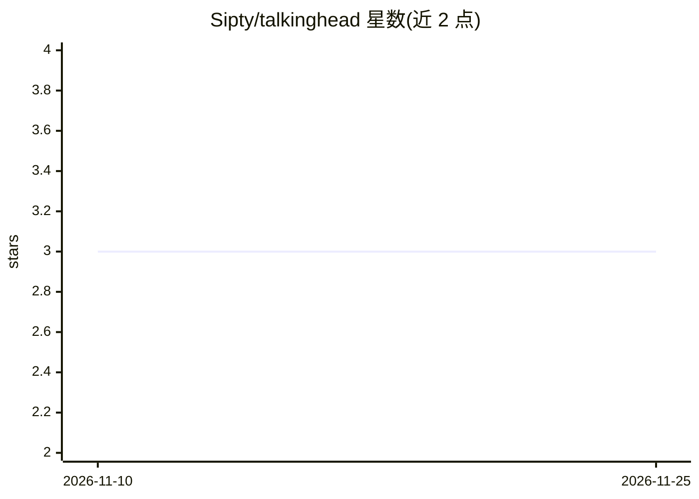

# Sipty/talkinghead

⭐ 3 · Python · MIT · 推送 2026-11-15 · [GitHub](https://github.com/Sipty/talkinghead) · [官网](https://exitnode.dev) · 个人维护

**把口播录像剪成成片的 CLI：LLM 评审逐刀说明理由**

一个命令行工具，输入一段口播（talking-head）录像，输出剪好的成片与编辑报告。它只做删减（预热、重录、跑题、长停顿、口头语），不撰写、不重录、不重排内容。编辑决策由用户指定的 LLM 评审做出，每次剪辑记录投票数并写入 report.md；剪辑、母带处理与校验全部在本机运行。转录支持 Whisper（本地模型，约 1.5 GB）、Parakeet（仅 macOS）与 Scribe v2（经 OpenRouter）。评审支持 Claude Code（headless）、任意 shell 命令或离线 dry-run 评审。源码运行，非 pip 包。

## 筛选速览

| 维度 | 判定 | 备注 |
|---|---|---|
| AI 角色 | `ai-native` | 本体是模型或模型工具 |
| 许可风险 | `permissive` | MIT |
| 部署形态 | `desktop` | 安装包/桌面程序 |
| 模型依赖 | locked-api |  |
| 硬件要求 | — | 无带数字的原话,不猜 |
| 安装摩擦 | `medium` | 含编译或系统依赖之一 |
| 成熟度 | — | 结构信号不足 |

## 能力要点

- LLM 评审逐项投票决定每处剪辑，理由与票数写入 report.md
- 三种转录后端：Whisper（本地大模型）、Parakeet（仅 macOS）、Scribe v2（经 OpenRouter）
- 本地运行：剪辑、母带与校验均在自己机器上执行，含离线 dry-run 冒烟测试
- 支持 --brief/--topic 提供内容上下文、--plan-only 与 --demo 预览、内容寻址缓存与个人编辑偏好档案

## 适用场景

- 把录好的口播视频自动剪掉停顿和口头语，得到可发布的成片
- 逐刀查看 AI 剪辑理由与投票记录，确认后才交付
- 在无 API key 的离线冒烟测试中先验证安装是否正常

## 场景标签

`图像视频处理` · 领域:感知与多模态

## 证据(README 行号)

> L3: talkinghead turns one talking-head recording into a finished cut and a report that says why each cut was made.
> L6: An LLM judge that you choose makes the editorial calls, and every call is recorded with its vote count.
> L178: |`TALKINGHEAD_JUDGE`|yes, unless `--judge` or `judge` in the config file is set|`claude`, or `shell:<command>`|the

## 星数曲线

2026-11-10 3 → 2026-11-25 3（+0）

---
*卡片 v1 · prompt 1.4 · 生成 2026-11-22 · 置信度 high · 依据 README sha `7dbdfc13fb4c` · [字段定义](../../DATASET.md)*
