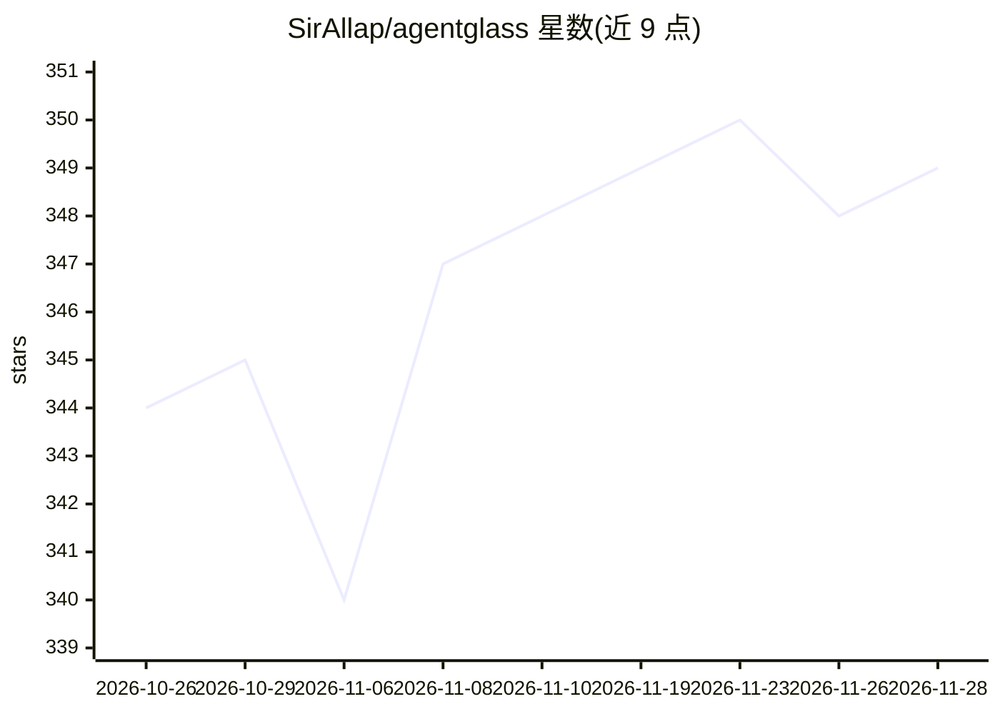

# SirAllap/agentglass

⭐ 349 · TypeScript · MIT · 推送 2026-11-27 · [GitHub](https://github.com/SirAllap/agentglass) · [官网](https://sirallap.github.io/agentglass/) · 个人维护

**把多个编码 agent 的终端、成本与审批集中到一个桌面窗口**

一个本地桌面工作台：将 tmux 中已运行的 Claude Code、Codex、Gemini CLI、OpenCode 会话集中展示与启动，提供实时成本与 token 统计、diff 查看、PR 审阅、可驱动 agent 的浏览器面板，以及需要人工放行的工具调用审批队列（桌面或手机端批准）。面向同时运行多个编码 agent 的开发者。数据存本机 SQLite，无账号无遥测；安全模型为策略锁定而非沙箱，SECURITY.md 说明边界。

## 筛选速览

| 维度 | 判定 | 备注 |
|---|---|---|
| AI 角色 | `ai-ecosystem` | LLM/agent 周边工具 |
| 许可风险 | `permissive` | MIT |
| 部署形态 | `desktop` | 安装包/桌面程序 |
| 模型依赖 | — | README 未给出锁定关系 |
| 硬件要求 | — | 无带数字的原话,不猜 |
| 安装摩擦 | `low` | 无编译、无系统依赖或容器化 |
| 成熟度 | — | 结构信号不足 |

## 能力要点

- 集中管理多个编码 agent 会话：附加 tmux 或从任务/issue 自动建 worktree 与分支启动
- 工具调用审批门控：被门控的调用需在桌面或手机端放行，队列落盘
- 实时显示每个会话的成本、token 与工具调用
- Android 伴侣应用扫码配对，远程查看终端与审批

## 适用场景

- 同时跑多个编码 agent 时在单一窗口查看状态与成本
- 出门时用手机批准被门控的危险操作
- 审阅 agent 产出的 diff 与 pull request

## 场景标签

`编码 Agent` `LLM 可观测性` · 领域:编码与开发

## 证据(README 行号)

> L3: **The workspace for your coding agents: their terminals, pull requests, diffs, a browser they can drive and every ap
> L17: away. agentglass is one desktop window that holds all of it. Claude Code, Codex,
> L110: No. Your agents are the same CLIs you already run. agentglass attaches to the

## 星数曲线

2026-10-26 344 → 2026-11-28 349（+5）

---
*卡片 v1 · prompt 1.4 · 生成 2026-11-25 · 置信度 high · 依据 README sha `a30dc135b6f2` · [字段定义](../../DATASET.md)*
