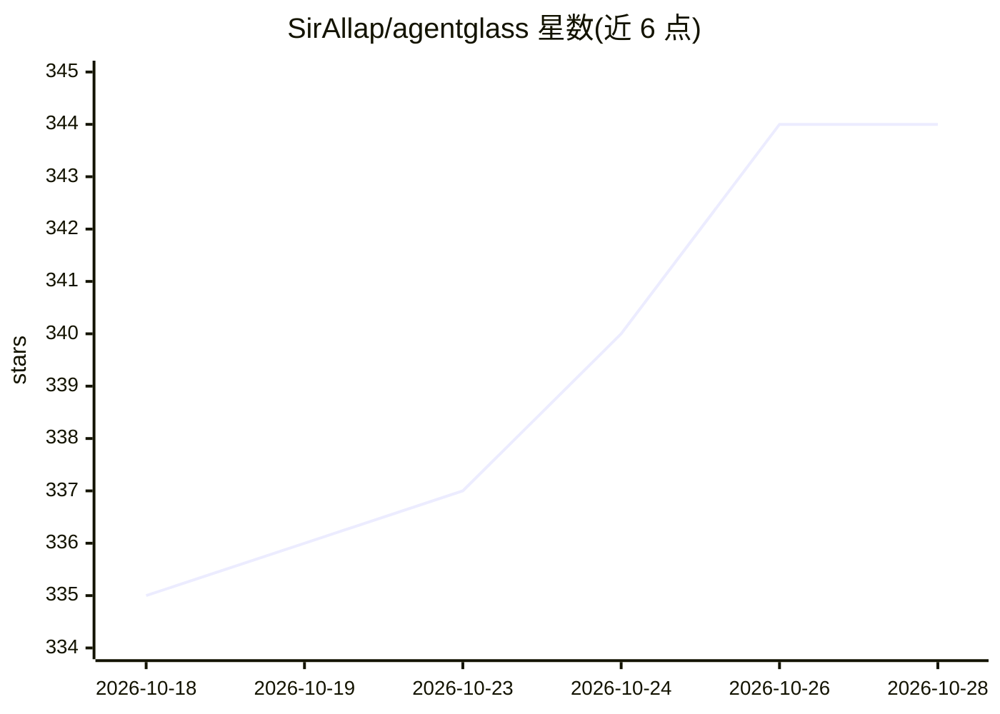

# SirAllap/agentglass

⭐ 345 · TypeScript · MIT · 推送 2026-10-28 · [GitHub](https://github.com/SirAllap/agentglass) · [官网](https://sirallap.github.io/agentglass/) · 个人维护

**本地桌面工作台：集中查看与审批多个 AI 编码 agent**

单窗口桌面应用，附加到本机 tmux 会话中已运行的 Claude Code、Codex、Gemini CLI 与 OpenCode，聚合展示终端、diff、PR、浏览器面板、成本/token/工具调用与 Docker 等运行状态。提供权限门控与审批队列（落盘，可从手机应答），支持一个任务或 issue 生成 worktree 并启动 agent，附 Android 配套应用。数据存本地 SQLite，默认无遥测；必需依赖为 git、Claude Code CLI 与 Python 3，tmux/GitHub CLI/Docker 按功能可选。Linux/macOS 提供安装包，Windows 未在真机验证。

## 筛选速览

| 维度 | 判定 | 备注 |
|---|---|---|
| AI 角色 | `ai-ecosystem` | LLM/agent 周边工具 |
| 许可风险 | `permissive` | MIT |
| 部署形态 | `desktop` | 安装包/桌面程序 |
| 模型依赖 | — | README 未给出锁定关系 |
| 硬件要求 | — | 无带数字的原话,不猜 |
| 安装摩擦 | `low` | 无编译、无系统依赖或容器化 |
| 成熟度 | — | 结构信号不足 |

## 能力要点

- 附加到 tmux 中已运行的 Claude Code/Codex/Gemini CLI/OpenCode 会话
- 权限门控审批队列落盘，可经 Android 配套应用远程应答
- 任务或 GitHub issue 一键生成 worktree、分支并启动 agent
- 本地 SQLite 存储，无账号无云端，仅两条默认关闭的出站路径

## 适用场景

- 同时跑多个编码 agent 时在单窗口查看终端、diff 与 PR
- 在手机上应答等待权限审批的 agent
- 按 worktree 隔离并行运行多个 agent 并追踪各自成本

## 场景标签

`编码 Agent` `LLM 可观测性` · 领域:编码与开发

## 证据(README 行号)

> L17: away. agentglass is one desktop window that holds all of it. Claude Code, Codex,
> L18: Gemini CLI and OpenCode keep running where they already run — in tmux, in your
> L104: No. Your agents are the same CLIs you already run. agentglass attaches to the

## 星数曲线

2026-10-18 335 → 2026-10-28 344（+9）

---
*卡片 v1 · prompt 1.4 · 生成 2026-10-22 · 置信度 high · 依据 README sha `113d465a6522` · [字段定义](../../DATASET.md)*
