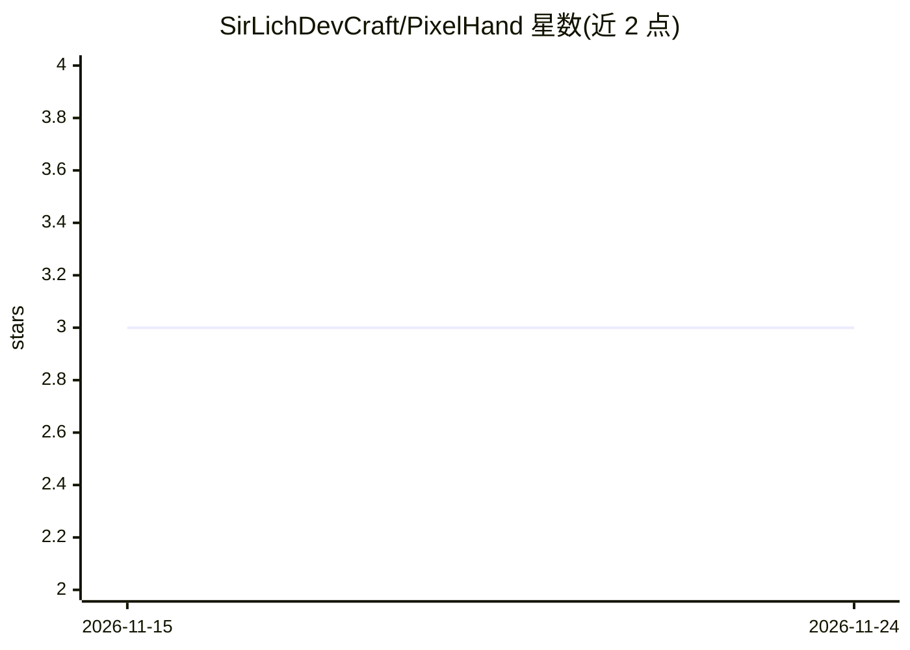

# SirLichDevCraft/PixelHand

⭐ 3 · JavaScript · MIT · 推送 2026-10-20 · [GitHub](https://github.com/SirLichDevCraft/PixelHand) · [官网](https://github.com/SirLichDevCraft/PixelHand#readme) · 个人维护

**让 AI agent 通过 MCP/CLI/JS 生成像素画的引擎**

一个开源像素画引擎，通过 MCP、CLI 或 JavaScript 接口创建 sprite、动画与游戏美术。核心机制包括调色板索引像素、可编辑文本网格、逐帧视觉审阅，以及原生比例渲染、剪影、差异图等检查工具。项目以普通文件存储美术源，可版本化与迁移；核心零运行时依赖，要求 Node.js 20.3+。README 说明示例由人工与引擎协作完成，并非模型自主生成的基准结果。

## 筛选速览

| 维度 | 判定 | 备注 |
|---|---|---|
| AI 角色 | `ai-ecosystem` | LLM/agent 周边工具 |
| 许可风险 | `permissive` | MIT |
| 部署形态 | `None` |  |
| 模型依赖 | local-ok | 支持本地模型 |
| 硬件要求 | — | 无带数字的原话,不猜 |
| 安装摩擦 | `low` | 无编译、无系统依赖或容器化 |
| 成熟度 | `idea` | |

## 能力要点

- 通过 stdio MCP server、CLI、JavaScript 三种接口驱动像素创作
- 调色板索引像素、可编辑文本网格与原子化编辑批次
- 八方向动画 rig、逐帧审阅、contact sheet 与 GIF 回放
- 核心零运行时依赖，美术源以普通文件存储可 diff

## 适用场景

- 为 2D 游戏生成可编辑的 sprite 与 tile 资产
- 把像素美术创作接入 MCP 兼容的 coding agent 工作流
- 制作八方向角色行走动画并逐帧审阅
- 管理带风格规范与调色板规则的美术项目

## 场景标签

`图像生成` · 领域:内容生成

## 证据(README 行号)

> L9: An open-source engine for creating sprites, animation, and game art through **MCP, CLI, or JavaScript**. Local and A
> L81: PixelHand exposes a stdio MCP server. In Zed, add this to `settings.json`, replacing the path with your checkout. W
> L90: The compact `core` profile provides discovery and everyday editing. An agent can find specialist tools with `tool_s

## 星数曲线

2026-11-15 3 → 2026-11-24 3（+0）

---
*卡片 v1 · prompt 1.4 · 生成 2026-11-22 · 置信度 high · 依据 README sha `19844be485b2` · [字段定义](../../DATASET.md)*
