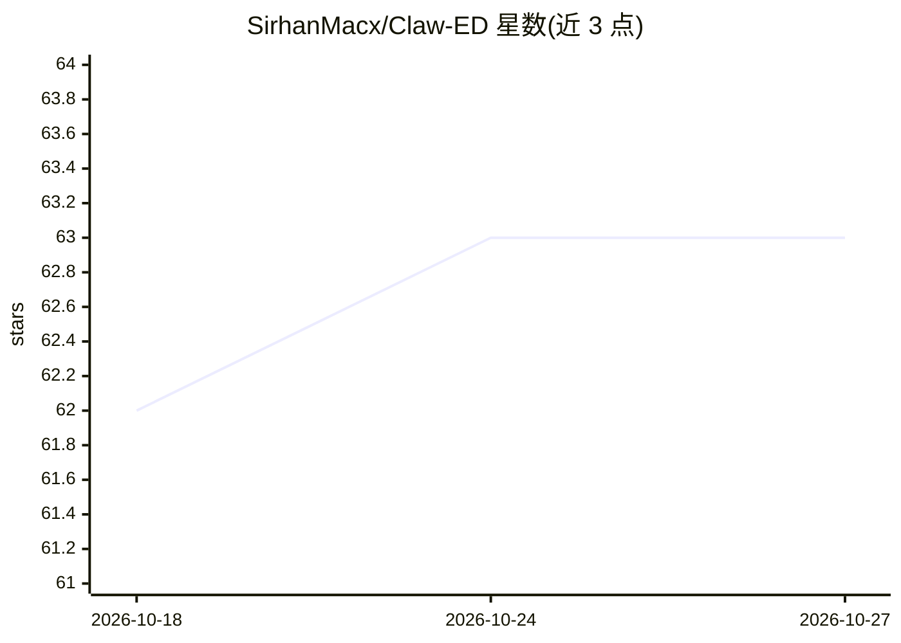

# SirhanMacx/Claw-ED

⭐ 63 · Python · MIT · 推送 2026-09-19 · [GitHub](https://github.com/SirhanMacx/Claw-ED) · [官网](https://sirhanmacx.github.io/Claw-ED) · 组织维护

**本地优先的 AI 教学助手：用教师自有课件生成可编辑教案与课件**

面向教师（单教师单实例）的本地优先 AI 助手：导入 PDF/DOCX/PPTX/TXT/Markdown 教学材料后进行文本抽取、检索索引与教学风格画像，再按主题、年级、学科生成教师版 DOCX、学生版 DOCX 与 PPTX 课件，教师需在常用工具中审阅编辑。支持 Anthropic、OpenAI、Gemini、Ollama、OpenRouter 等提供方适配器，配置与数据默认存于 ~/.eduagent/。以 Python 包（3.11+）安装，提供 CLI、本地仪表盘与 API；处于 Beta 阶段，学生端功能为实验性。

## 筛选速览

| 维度 | 判定 | 备注 |
|---|---|---|
| AI 角色 | `ai-native` | 本体是模型或模型工具 |
| 许可风险 | `permissive` | MIT |
| 部署形态 | `library` | 以包/库形式分发 |
| 模型依赖 | local-ok | 支持本地模型 |
| 硬件要求 | — | 无带数字的原话,不猜 |
| 安装摩擦 | `low` | 无编译、无系统依赖或容器化 |
| 成熟度 | `idea` | |

## 能力要点

- 导入既有课件建立检索索引与教学风格画像，生成教师/学生文档与幻灯片
- 提供方适配器覆盖 Anthropic/OpenAI/Gemini/Ollama/OpenRouter，模型自选
- CLI 与本地仪表盘/API，含任务队列的取消、恢复、续跑命令
- 配置与工作数据默认本地存储，本地推理可避免云端处理

## 适用场景

- 基于已有教案和课件快速起草新课的教案与学生材料
- 生成课堂演示用的 PPTX 幻灯片并自行编辑校对
- 使用本地模型（如 Ollama）处理含学生内容的材料以减少外发数据

## 场景标签

`AI 写作` · 领域:内容生成

## 证据(README 行号)

> L5: Claw-ED is a local-first AI teaching assistant. Start with your existing lesson plans, slides, and assessments; use 
> L82: Provider adapters support Anthropic, OpenAI, Google Gemini, Ollama, and OpenRouter. Model support and tool behavior

## 星数曲线

2026-10-18 62 → 2026-10-27 63（+1）

---
*卡片 v1 · prompt 1.4 · 生成 2026-10-24 · 置信度 high · 依据 README sha `fb21e5c3ef85` · [字段定义](../../DATASET.md)*
