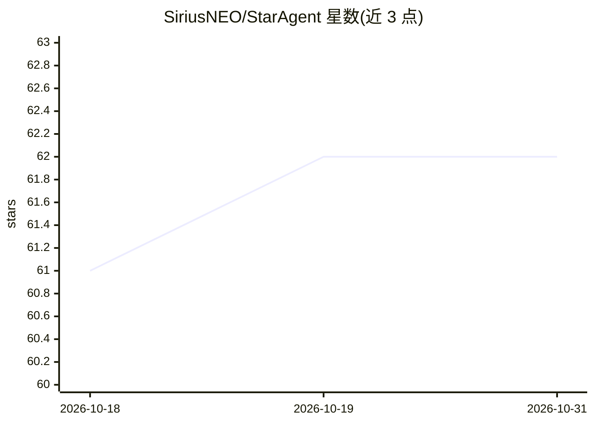

# SiriusNEO/StarAgent

⭐ 62 · Python · MIT · 推送 2026-10-01 · [GitHub](https://github.com/SiriusNEO/StarAgent) · 个人维护 · 中文 README

**本地优先的编码 Agent 会话启动器与多节点管理面板**

面向在多个工作目录并行运行 Codex / Claude Code 等 Agent CLI 的用户：以平台原生持久终端（Windows ConPTY、Linux/macOS tmux）承载长会话，通过 Tailscale 实现跨机器连接，浏览器即可在任意设备访问统一 Web 面板，管理会话状态、登录凭证、模型选择与 Agent CLI 安装更新。提供单机 Launcher 与多节点 Hub 两种模式，并有 Tauri 桌面安装包。README 声明项目处于活跃开发、主要面向个人使用，由 vibe coding 构建，可能含 bug。

## 筛选速览

| 维度 | 判定 | 备注 |
|---|---|---|
| AI 角色 | `ai-ecosystem` | LLM/agent 周边工具 |
| 许可风险 | `permissive` | MIT |
| 部署形态 | `desktop` | 安装包/桌面程序 |
| 模型依赖 | — | README 未给出锁定关系 |
| 硬件要求 | — | 无带数字的原话,不猜 |
| 安装摩擦 | `low` | 无编译、无系统依赖或容器化 |
| 成熟度 | `idea` | |

## 能力要点

- 平台原生持久终端（ConPTY / tmux）保持 Agent 会话长生命周期
- 经 Tailscale 的跨机器连接，浏览器即可从任意设备管理会话
- Web 面板含会话聊天控制台、终端与文件浏览
- Tauri 桌面包内置 Python 运行时与原生终端后端，Windows/Linux/macOS 可用

## 适用场景

- 并行管理多个编码 Agent CLI 会话，一处查看状态并实时交互
- 从手机或任意浏览器接管家中/服务器上的 Agent 会话
- 免手工编辑厂商配置即可切换 Agent 登录凭证与模型默认值

## 场景标签

 · 领域:开发者工具/Agent 基础设施

## 证据(README 行号)

> L11: StarAgent is a local-first **Agent Harness Launcher** and an optional multi-Node Hub for managing coding agent sess
> L13: > **We need a lightweight persistent terminal wrapper for Codex / Claude Code that supports cross-machine connectio

## 星数曲线

2026-10-18 61 → 2026-10-31 62（+1）

---
*卡片 v1 · prompt 1.4 · 生成 2026-10-24 · 置信度 high · 依据 README sha `2c117e336e61` · [字段定义](../../DATASET.md)*
