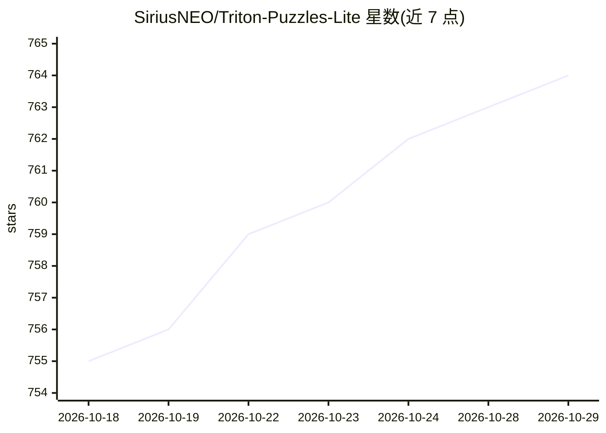

# SiriusNEO/Triton-Puzzles-Lite

⭐ 764 · Python · Apache-2.0 · 推送 2026-03-17 · [GitHub](https://github.com/SiriusNEO/Triton-Puzzles-Lite) · 个人维护

**学习 Triton 编程的入门练习题集（CPU 解释器模式）**

由 Triton-Puzzles 精简而来的教学练习仓库：通过在 puzzles.py 中按序阅读并完成一系列 Triton kernel 练习来学习 Triton 编译器编程。关键机制是仅依赖 PyTorch（自带 Triton 与 NumPy），全部谜题可在 CPU 上通过 Triton 解释器运行，无需 GPU 配置，也可选在 GPU 上运行。相比原版移除了可视化部分并从 Jupyter notebook 改为 Python 脚本；增强了调试功能（打印中间值、定位输出差异、检测非法内存访问）。已知 Puzzle 11、12 在 GPU 模式失败，且与 NumPy 2.0 存在兼容性问题。

## 筛选速览

| 维度 | 判定 | 备注 |
|---|---|---|
| AI 角色 | `ai-knowledge` | 知识聚合/清单类 |
| 许可风险 | `permissive` | Apache-2.0 |
| 部署形态 | `library` | 以包/库形式分发 |
| 模型依赖 | — | README 未给出锁定关系 |
| 硬件要求 | — | 无带数字的原话,不猜 |
| 安装摩擦 | `low` | 无编译、无系统依赖或容器化 |
| 成熟度 | — | 结构信号不足 |

## 能力要点

- 谜题全部可在 CPU 上通过 Triton 解释器运行，无需 GPU
- 仅需安装 PyTorch（附带 Triton 与 NumPy），依赖精简
- 增强调试：打印中间值、差异定位、非法内存访问检测
- 从 Jupyter notebook 改为单文件 Python 脚本 puzzles.py

## 适用场景

- 初学者在无 GPU 环境下入门 Triton kernel 编程
- 通过渐进式练习掌握 Triton 语法与调试方法
- 对照 puzzles_ans.py 参考答案自查练习结果

## 场景标签

`教程课程` · 领域:学习与行业

## 证据(README 行号)

> L3: Modified from Triton-Puzzles by Sasha Rush and others, which is a good educational notebook for learning Triton comp
> L21: The main content is integrated in this single file: `puzzles.py`. Read through it in order and complete the exercis

## 星数曲线

2026-10-18 755 → 2026-10-29 764（+9）

---
*卡片 v1 · prompt 1.4 · 生成 2026-10-21 · 置信度 high · 依据 README sha `21214fc9cd51` · [字段定义](../../DATASET.md)*
