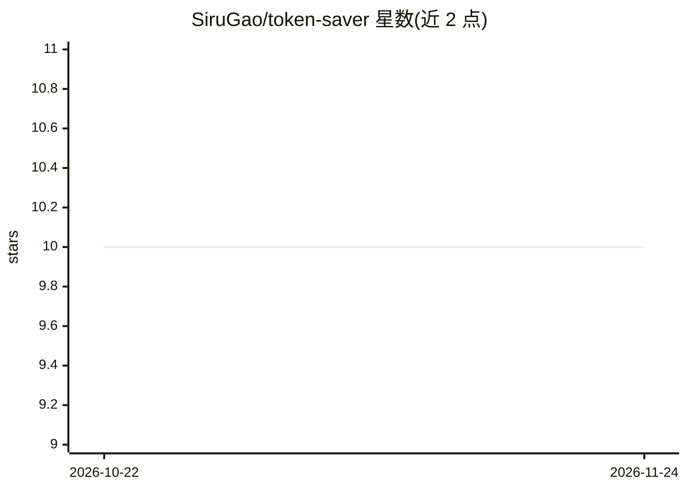

# SiruGao/token-saver

⭐ 10 · TypeScript · NOASSERTION · 推送 2026-06-26 · [GitHub](https://github.com/SiruGao/token-saver) · [官网](https://github.com/SiruGao/token-saver) · 个人维护 · 中文 README

**本地桌面应用：诊断 AI agent 的 token 浪费并核验成本**

本地优先的 Tauri 2 桌面应用，围绕 AI-agent token 效率提供控制层：Doctor 模块用六条确定性规则识别重复上下文、超大输出、缓存漂移等浪费模式；Strategy Hub 将发现映射到兼容的第三方压缩策略注册表；Proof 计划对比 token、重试、延迟与任务质量。核心指标为每成功任务成本。V1 为只读分析器，不自动执行第三方策略、不修改 agent 配置，转录需用户显式导入，分析在本地运行。

## 筛选速览

| 维度 | 判定 | 备注 |
|---|---|---|
| AI 角色 | `ai-ecosystem` | LLM/agent 周边工具 |
| 许可风险 | `permissive` | NOASSERTION |
| 部署形态 | `library` | 以包/库形式分发 |
| 模型依赖 | — | README 未给出锁定关系 |
| 硬件要求 | — | 无带数字的原话,不猜 |
| 安装摩擦 | `low` | 无编译、无系统依赖或容器化 |
| 成熟度 | `idea` | |

## 能力要点

- 六条确定性 Doctor 规则识别重复读取、重复工具输出、指令过长、前缀漂移等浪费
- Strategy Hub 中立注册表：RTK、Headroom、Claw Compactor 及兼容性元数据
- 以 cost per successful task 为核心度量指标
- 本地分析，无账号、无遥测，数据可导出删除

## 适用场景

- 诊断 Claude Code、Codex 等 agent 会话转录中的 token 浪费
- 为不同 agent 任务挑选并跟踪兼容的上下文压缩工具
- 离线环境本地分析转录且不上传数据

## 场景标签

`LLM 可观测性` · 领域:评测与运维

## 证据(README 行号)

> L17: Token Saver is a local-first desktop application that diagnoses AI-agent token waste and coordinates compatible thi
> L19: It is not trying to own every compression algorithm. The product is the control loop around them:
> L127: V1 does not yet execute strategy adapters, install upstream tools, ingest transcripts automatically, proxy provide

## 星数曲线

2026-10-22 10 → 2026-11-24 10（+0）

---
*卡片 v1 · prompt 1.4 · 生成 2026-11-20 · 置信度 high · 依据 README sha `ec603c027026` · [字段定义](../../DATASET.md)*
