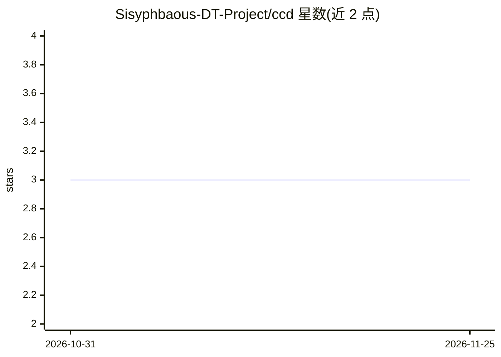

# Sisyphbaous-DT-Project/ccd

⭐ 3 · Go · AGPL-3.0 · 推送 2026-11-07 · [GitHub](https://github.com/Sisyphbaous-DT-Project/ccd) · 组织维护 · 中文 README

**给 new-api 前置的思维链转述服务，把长思维链摘要成简短工作笔记**

部署在 new-api 之前的反向代理中间件：推理模型的原始思维链分段交给另一个模型转述为第一人称简短笔记后流式展示给用户，原始思维链存服务器，下一轮请求按字节级局部替换换回原版再交上游。支持 OpenAI 与 Anthropic 格式的流式/同步请求，规则在 new-api 后台面板按分组/模型/key 配置，转述使用用户已有 key。要求 new-api v1.0 及其数据库，源码需 Go 1.26 构建。

## 筛选速览

| 维度 | 判定 | 备注 |
|---|---|---|
| AI 角色 | `ai-ecosystem` | LLM/agent 周边工具 |
| 许可风险 | `viral` | AGPL-3.0 |
| 部署形态 | `self-host` | docker 或自建部署 |
| 模型依赖 | — | README 未给出锁定关系 |
| 硬件要求 | — | 无带数字的原话,不猜 |
| 安装摩擦 | `low` | 无编译、无系统依赖或容器化 |
| 成熟度 | — | 结构信号不足 |

## 能力要点

- 原始思维链存服务器，多轮对话中换回原版，模型侧不受影响
- 支持 /v1/chat/completions、Anthropic /v1/messages、OpenAI /v1/responses 三种格式
- 字节级 JSON 局部替换，未命中规则的请求逐字节透传
- 注入 new-api 日志页的后台面板，按分组/模型/key 配置规则

## 适用场景

- 给 new-api 网关的用户展示更简短的推理过程摘要
- 多轮对话和工具调用场景下保留原始思维链
- 按分组或 key 灵活控制哪些请求做思维链转述

## 场景标签

 · 领域:LLM 基础设施/推理增强

## 证据(README 行号)

> L13: ccd 把同样的做法带到了 new-api 上。它是一个放在 new-api 前面的小服务：
> L30: - **格式**：`/v1/chat/completions`、Anthropic `/v1/messages` 与 OpenAI `/v1/responses`，流式和同步都支持，包括多个 thinking 块穿插工具调用、`r

## 星数曲线

2026-10-31 3 → 2026-11-25 3（+0）

---
*卡片 v1 · prompt 1.4 · 生成 2026-11-22 · 置信度 high · 依据 README sha `eab03b8c956f` · [字段定义](../../DATASET.md)*
