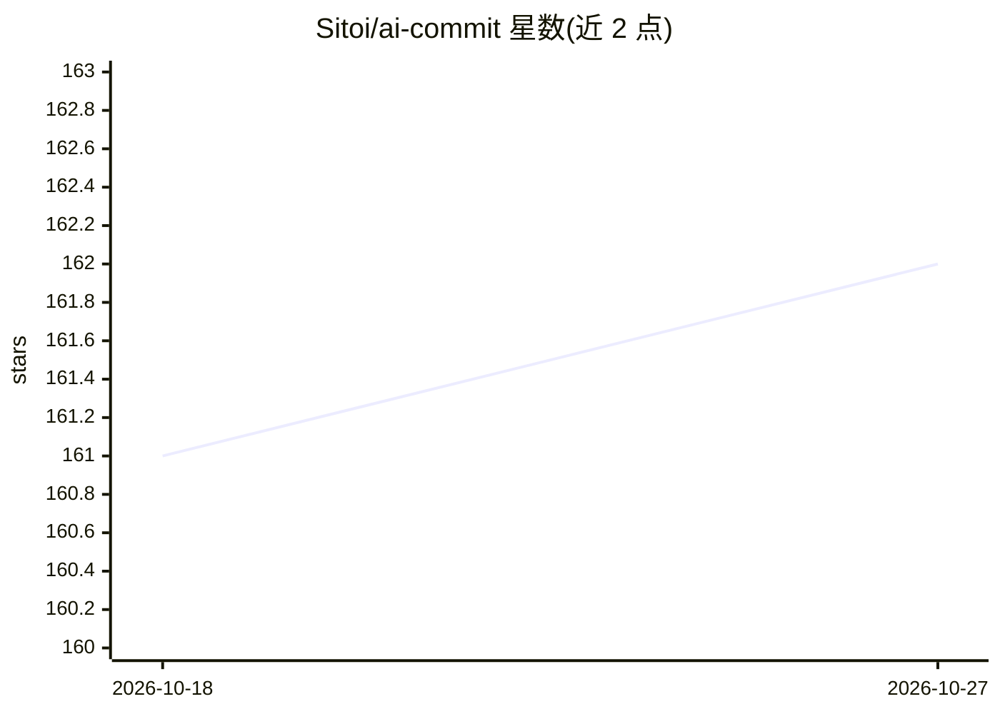

# Sitoi/ai-commit

⭐ 162 · TypeScript · MIT · 推送 2026-05-05 · [GitHub](https://github.com/Sitoi/ai-commit) · [官网](https://marketplace.visualstudio.com/items?itemName=Sitoi.ai-commit) · 个人维护 · 中文 README

**VSCode 扩展：用 LLM API 生成符合规范的 Git 提交信息**

AI Commit 是一个 VSCode 扩展，读取暂存区 git diff，调用 OpenAI / Azure OpenAI / DeepSeek / Grok / Gemini / Claude API 生成符合 Conventional Commits 规范的提交信息，填入源代码管理面板输入框供用户审阅后提交。支持 19 种输出语言、Gitmoji、自定义 system prompt，以及 OpenAI Responses API 的推理力度与输出详略配置。通过 VSCode 市场安装，本地开发需 Node ≥16 并 npm install。限制：代码超过最大 token 长度时需分批暂存。

## 筛选速览

| 维度 | 判定 | 备注 |
|---|---|---|
| AI 角色 | `ai-native` | 本体是模型或模型工具 |
| 许可风险 | `permissive` | MIT |
| 部署形态 | `library` | 以包/库形式分发 |
| 模型依赖 | locked-api |  |
| 硬件要求 | — | 无带数字的原话,不猜 |
| 安装摩擦 | `low` | 无编译、无系统依赖或容器化 |
| 成熟度 | — | 结构信号不足 |

## 能力要点

- 基于 git diff 调用 6 家 LLM API 生成提交信息
- 遵循 Conventional Commits 规范，支持 Gitmoji 与自定义 system prompt
- 支持 19 种语言的提交信息输出
- 支持 OpenAI Responses API 的 reasoning effort 与 verbosity 配置

## 适用场景

- 写提交信息时让 AI 根据 diff 自动生成规范格式
- 团队统一提交信息语言与 Conventional Commits 风格
- 在提交前补充上下文说明以影响生成结果

## 场景标签

`AI 写作` · 领域:内容生成

## 证据(README 行号)

> L3: Use OpenAI / Azure OpenAI / DeepSeek / Grok / Gemini / Claude (Anthropic) API to review Git changes, generate conven
> L18: - 🤯 Support generating commit messages based on git diffs using OpenAI / Azure OpenAI / DeepSeek / Grok / Gemini / 
> L39: 5. Next to the commit message input box in the "Source Control" panel, click the "AI Commit" icon button. After cli

## 星数曲线

2026-10-18 161 → 2026-10-27 162（+1）

---
*卡片 v1 · prompt 1.4 · 生成 2026-10-22 · 置信度 mid · 依据 README sha `4f5db2b6a607` · [字段定义](../../DATASET.md)*
