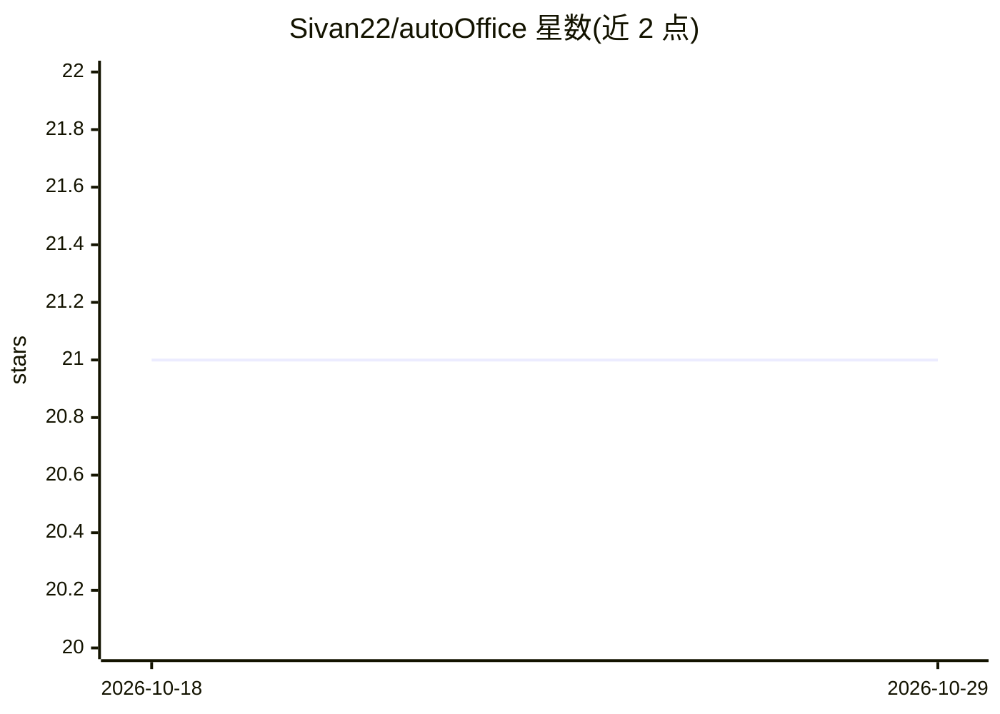

# Sivan22/autoOffice

⭐ 21 · TypeScript · MIT · 推送 2026-05-13 · [GitHub](https://github.com/Sivan22/autoOffice) · 个人维护

**开源 Word/Excel/PPT AI 助手加载项，生成并执行 office.js**

MIT 许可的 Microsoft Office 任务窗格加载项：用户用自然语言描述任务，Agent 查阅 office.js API 文档、生成代码、经用户批准后在沙箱 iframe 中对活动文档执行，出错时回喂 LLM 最多重试 3 次。提供 Windows 预构建安装包，也可自行托管到 GitHub Pages。支持 Anthropic、OpenAI 及任意 OpenAI 兼容端点（含 Ollama、LM Studio），API key 本地存储；仅支持 HTTP/SSE 的 MCP 服务器，不支持 stdio。

## 筛选速览

| 维度 | 判定 | 备注 |
|---|---|---|
| AI 角色 | `ai-native` | 本体是模型或模型工具 |
| 许可风险 | `permissive` | MIT |
| 部署形态 | `desktop` | 安装包/桌面程序 |
| 模型依赖 | local-ok | 支持本地模型 |
| 硬件要求 | — | 无带数字的原话,不猜 |
| 安装摩擦 | `low` | 无编译、无系统依赖或容器化 |
| 成熟度 | — | 结构信号不足 |

## 能力要点

- 生成并执行真实 office.js 代码，运行前展示代码供批准
- 错误自愈：执行失败回喂 LLM 重试最多 3 次
- 接入 HTTP/SSE MCP 服务器扩展外部工具
- 支持本地模型（Ollama、任意 OpenAI 兼容端点），文档不出本机

## 适用场景

- 用对话让 AI 批量完成 Word/Excel/PPT 的格式化、表格、图表操作
- 在数据不出本机的前提下用本地模型处理 Office 文档
- 通过 MCP 服务器让 Agent 调用 Linear、Notion 等外部系统

## 场景标签

`AI 助手` · 领域:对话与助手

## 证据(README 行号)

> L5:  AI-powered Microsoft Word + Excel + PowerPoint add-in that writes and executes real <code>office.js</code> code on 
> L9: AutoOffice is a task-pane add-in you chat with. Describe what you want — for Word ("make all headings blue", "insert

## 星数曲线

2026-10-18 21 → 2026-10-29 21（+0）

---
*卡片 v1 · prompt 1.4 · 生成 2026-10-28 · 置信度 high · 依据 README sha `ce8b81289427` · [字段定义](../../DATASET.md)*
