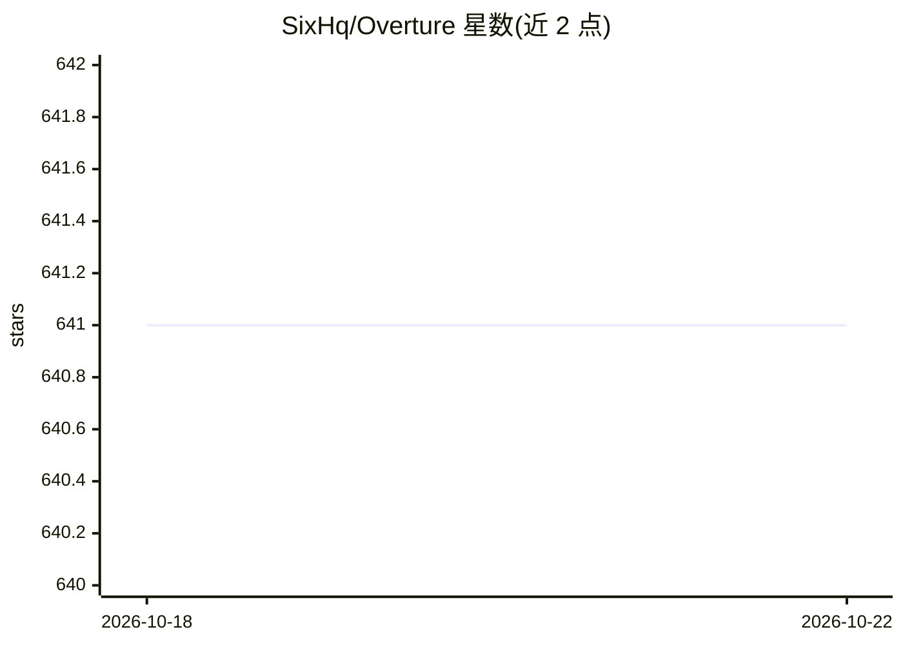

# SixHq/Overture

⭐ 641 · TypeScript · MIT · 推送 2026-03-08 · [GitHub](https://github.com/SixHq/Overture) · 组织维护

**把 AI 编程 agent 的执行计划可视化为流程图并审批执行的 MCP 服务器**

以 MCP 服务器形式在本地运行的 Web 界面，面向使用 Cursor、Claude Code、Cline、Copilot 等 agent 的开发者：拦截 agent 的规划阶段，将计划渲染为可缩放的交互式流程图，用户可在节点上附加文件、API key、LLM 指令、选择分支方案，审批后实时观看节点执行状态（暂停/恢复/重跑）。内建 MCP 服务器市场可按节点附加工具，计划自动保存于 ~/.overture/history.json 并支持恢复与差异对比。通过 npx 或 npm 全局安装，页面运行在 localhost:3031。

## 筛选速览

| 维度 | 判定 | 备注 |
|---|---|---|
| AI 角色 | `ai-ecosystem` | LLM/agent 周边工具 |
| 许可风险 | `permissive` | MIT |
| 部署形态 | `library` | 以包/库形式分发 |
| 模型依赖 | — | README 未给出锁定关系 |
| 硬件要求 | — | 无带数字的原话,不猜 |
| 安装摩擦 | `low` | 无编译、无系统依赖或容器化 |
| 成熟度 | — | 结构信号不足 |

## 能力要点

- 计划渲染为 React Flow 交互图，审批通过前 agent 不写代码
- 节点级动态字段（字符串/数字/密钥/文件）与分支方案对比选择
- 内建 MCP Marketplace，可按节点附加 MCP 服务器工具
- 计划自动保存、历史浏览、恢复与差异视图；暴露 11 个 MCP 工具

## 适用场景

- 在让 AI agent 动手写代码前先审查并批准其执行计划
- 对比 agent 提出的多个实现分支并选择其一
- 在执行中途暂停、修改计划或从某节点重跑
- 为特定步骤附加上下文文件与 API 密钥后再执行

## 场景标签

 · 领域:开发工具/AI Agent 基础设施

## 证据(README 行号)

> L48: **Overture** intercepts your AI agent's planning phase and renders it as an **interactive visual flowchart** — befo
> L71: Overture is an MCP server that works with **any MCP-compatible AI coding agent**. One command to install.
> L391: Overture exposes 11 MCP tools for agents to interact with:

## 星数曲线

2026-10-18 641 → 2026-10-22 641（+0）

---
*卡片 v1 · prompt 1.4 · 生成 2026-10-21 · 置信度 high · 依据 README sha `a68d53e6e97a` · [字段定义](../../DATASET.md)*
