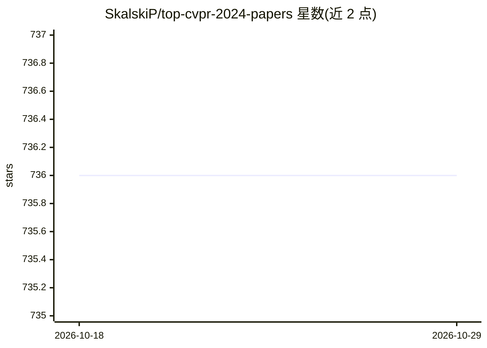

# SkalskiP/top-cvpr-2024-papers

⭐ 736 · Python · CC0-1.0 · 推送 2026-04-15 · [GitHub](https://github.com/SkalskiP/top-cvpr-2024-papers) · 个人维护

**CVPR 2024 精选论文清单：按主题组织并附代码/演示链接**

个人维护的 CVPR 2024 论文策展清单：从 11,532 篇投稿、2,719 篇录用中人工挑选条目，按 3D 重建、深度学习架构、文档分析、高效视觉、图像生成、多模态学习、检测识别、分割等主题分节组织；每条含论文链接，部分标注 🔥 高亮，并附代码、演示、视频或 Colab 链接，另链接完整录用论文列表。不提供代码本体，属纯浏览型目录。

## 筛选速览

| 维度 | 判定 | 备注 |
|---|---|---|
| AI 角色 | `ai-knowledge` | 知识聚合/清单类 |
| 许可风险 | `viral` | CC0-1.0 |
| 部署形态 | `None` |  |
| 模型依赖 | — | README 未给出锁定关系 |
| 硬件要求 | — | 无带数字的原话,不猜 |
| 安装摩擦 | `low` | 无编译、无系统依赖或容器化 |
| 成熟度 | — | 结构信号不足 |

## 能力要点

- 按会议主题分节组织论文条目
- 每条提供论文链接，部分附代码/演示/视频/Colab 链接
- 🔥 标记高亮论文
- 链接官方完整录用论文列表作为补充

## 适用场景

- 在 CVPR 2024 大量论文中查找值得阅读的精选条目
- 按主题（分割、检测、生成等）浏览相关论文及配套代码
- 获取论文的演示与 Colab 快速体验入口

## 场景标签

`精选清单` · 领域:学习与行业

## 证据(README 行号)

> L10: Computer Vision and Pattern Recognition is a massive conference. In **2024** alone,
> L11: **11,532** papers were submitted, and **2,719** were accepted. I created this repository
> L12: to help you search for crème de la crème of CVPR publications. If the paper you are

## 星数曲线

2026-10-18 736 → 2026-10-29 736（+0）

---
*卡片 v1 · prompt 1.4 · 生成 2026-10-21 · 置信度 high · 依据 README sha `48cafaac9f66` · [字段定义](../../DATASET.md)*
