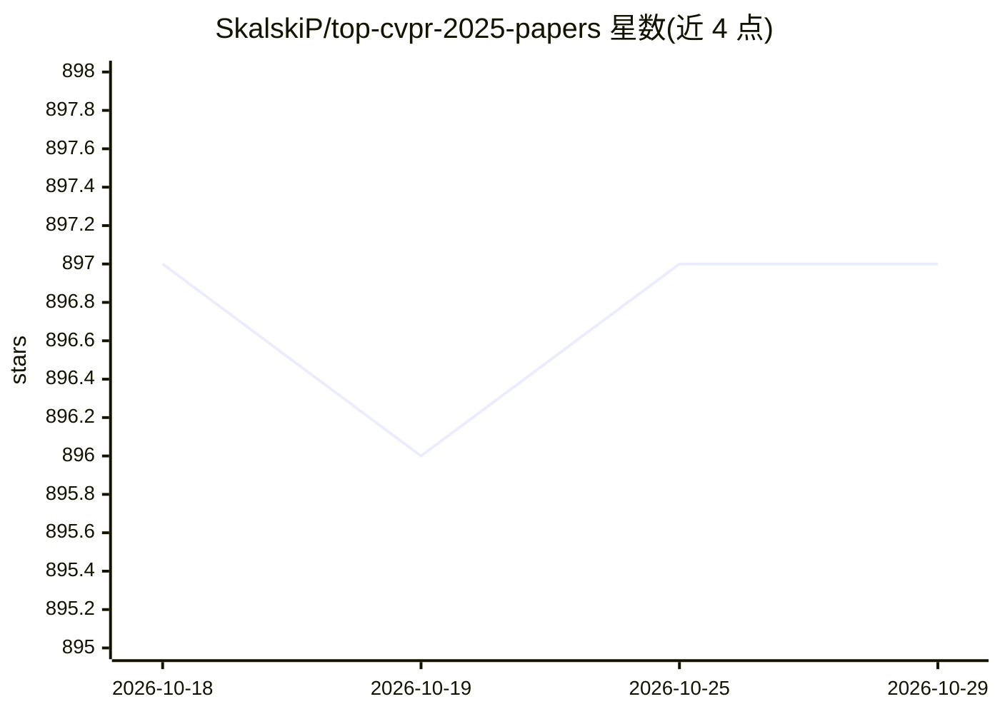

# SkalskiP/top-cvpr-2025-papers

⭐ 897 · Python · CC0-1.0 · 推送 2026-04-15 · [GitHub](https://github.com/SkalskiP/top-cvpr-2025-papers) · 个人维护

**CVPR 2025 精选论文清单：按主题组织并附代码/演示链接**

个人维护的 CVPR 2025 论文策展仓库：从 13,008 篇投稿、2,878 篇录用中挑选条目，按 3D 视觉、深度估计、生成模型、目标跟踪、开放世界检测等主题分类。每条目给出 arXiv 论文链接，部分附代码、视频、演示与 Colab 链接，并用🔥标记重点论文。仓库还提供 2023-2026 各年度姊妹清单的入口及完整录用论文列表指引。

## 筛选速览

| 维度 | 判定 | 备注 |
|---|---|---|
| AI 角色 | `ai-knowledge` | 知识聚合/清单类 |
| 许可风险 | `viral` | CC0-1.0 |
| 部署形态 | `None` |  |
| 模型依赖 | — | README 未给出锁定关系 |
| 硬件要求 | — | 无带数字的原话,不猜 |
| 安装摩擦 | `low` | 无编译、无系统依赖或容器化 |
| 成熟度 | — | 结构信号不足 |

## 能力要点

- 按主题（3D 视觉/深度估计/生成模型/目标跟踪等）组织的论文条目
- 每条目附 arXiv 链接，部分附代码/演示/视频/Colab
- 🔥 标记重点论文，附海报 PDF 与会场 Session 信息

## 适用场景

- 查找 CVPR 2025 各方向的重点论文及其代码
- 追踪特定主题（如深度估计、目标跟踪）的最新工作
- 通过 Demo/Colab 链接直接体验论文方法

## 场景标签

`精选清单` · 领域:学习与行业

## 证据(README 行号)

> L8: Computer Vision and Pattern Recognition is a massive conference. In **2025** alone,
> L10: to help you search for crème de la crème of CVPR publications. If the paper you are

## 星数曲线

2026-10-18 897 → 2026-10-29 897（+0）

---
*卡片 v1 · prompt 1.4 · 生成 2026-10-21 · 置信度 high · 依据 README sha `54529f0f8252` · [字段定义](../../DATASET.md)*
