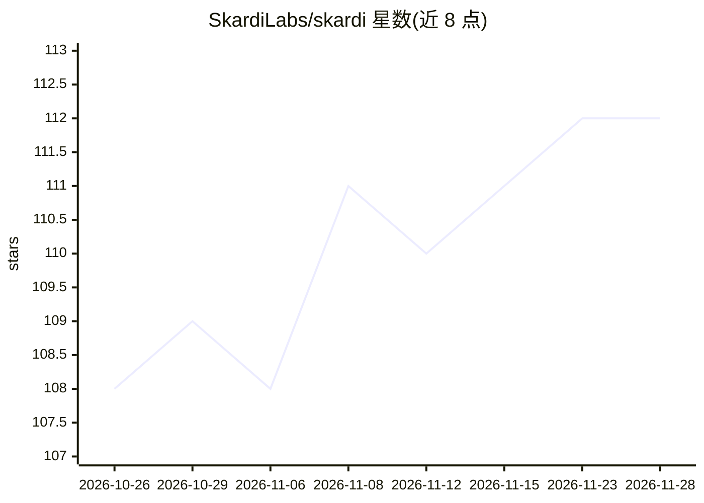

# SkardiLabs/skardi

⭐ 112 · Rust · Apache-2.0 · 推送 2026-11-27 · [GitHub](https://github.com/SkardiLabs/skardi) · [官网](https://skardi.ai) · 组织维护

**给 AI agent 提供自改进数据上下文的 Rust 框架**

Skardi 是一个面向 agent 的自改进上下文框架：agent 通过统一 SQL 查询已注册的数据源并在请求中声明用途，框架将每次查询连同意图写入审计账本；反复出现的查询可被提升为命名 pipeline，反复出现的意图可成为定时 routine。提升产物为可读、可回滚的 YAML。服务器为单 Rust 进程（内嵌 DataFusion），账本为 SQLite 或 Postgres；工具以 shell、REST 与 MCP 两种传输绑定暴露，并可安装到 Claude Code、Codex、Cursor 等 Agent Skills 宿主。README 标注处于 Beta，API 可能变动。

## 筛选速览

| 维度 | 判定 | 备注 |
|---|---|---|
| AI 角色 | `ai-ecosystem` | LLM/agent 周边工具 |
| 许可风险 | `permissive` | Apache-2.0 |
| 部署形态 | `desktop` | 安装包/桌面程序 |
| 模型依赖 | local-ok | 支持本地模型 |
| 硬件要求 | — | 无带数字的原话,不猜 |
| 安装摩擦 | `low` | 无编译、无系统依赖或容器化 |
| 成熟度 | `idea` | |

## 能力要点

- 查询带 ai_context 意图声明，写入可审计账本（SQLite/Postgres）
- 反复查询自动提升为 pipeline，支持 shell/REST/MCP 多绑定
- 四个 Agent Skills：auto-context、retrieval、graph-source、graph-rag
- 内置 access_mode 门控 DML、拒绝 DDL、日志不含字面值

## 适用场景

- 让 agent 用联邦 SQL 跨 Postgres/S3 Parquet/SaaS API 查询数据
- 把 agent 反复手写的查询沉淀为可复用 pipeline
- 为 agent 提供文档库或图数据的检索上下文（RAG）
- 通过 MCP 把数据工具接入 Claude Code、Cursor 等宿主

## 场景标签

`RAG` `Agent 记忆` · 领域:Agent 开发

## 证据(README 行号)

> L3: **Skardi is an open-source self-improving context framework.**
> L80: **4 — The agent has a new tool.** One definition, every binding — shell, REST,
> L163: searchable context served over HTTP by `skardi-server`: hybrid search (vector +

## 星数曲线

2026-10-26 108 → 2026-11-28 112（+4）

---
*卡片 v1 · prompt 1.4 · 生成 2026-11-28 · 置信度 high · 依据 README sha `7fba94861e30` · [字段定义](../../DATASET.md)*
