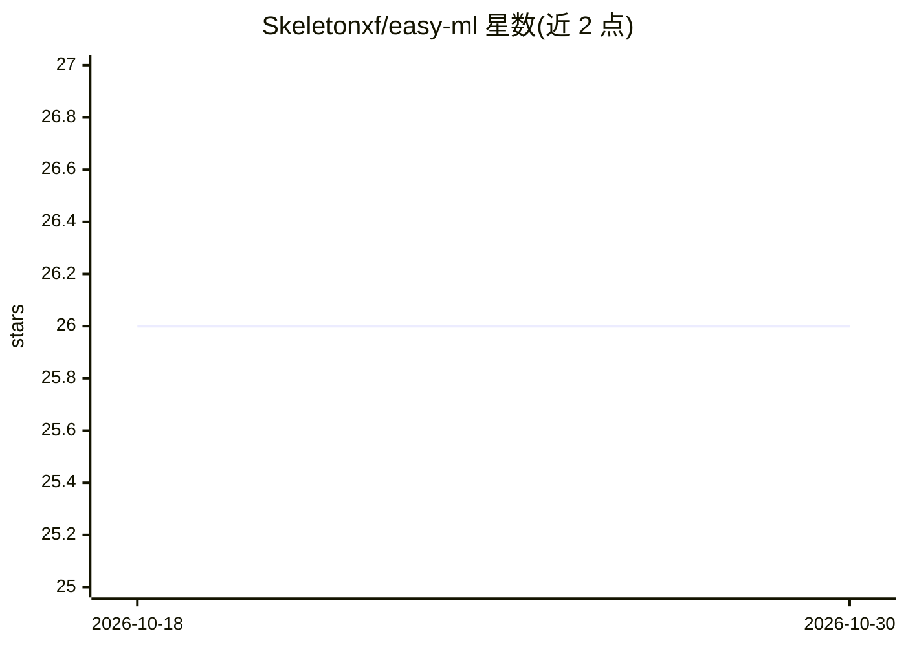

# Skeletonxf/easy-ml

⭐ 26 · Rust · MPL-2.0 · 推送 2026-10-21 · [GitHub](https://github.com/Skeletonxf/easy-ml) · [官网](https://crates.io/crates/easy-ml) · 个人维护

**纯 Rust 机器学习库：张量、矩阵、线性代数与自动微分**

完全确定性的纯 Rust 机器学习库，提供命名张量、矩阵、线性代数与梯度下降 API，支持前向与反向自动微分，数值类型可泛化（如 BigInt）。实现偏教科书数学定义，不做深度优化；不封装具体算法对象，控制流由调用方代码决定。张量维度在运行时以字符串命名、秩在编译期确定，避免维度混淆。支持编译到 Web Assembly，以 cargo 依赖方式使用。

## 筛选速览

| 维度 | 判定 | 备注 |
|---|---|---|
| AI 角色 | `ai-native` | 本体是模型或模型工具 |
| 许可风险 | `permissive` | MPL-2.0 |
| 部署形态 | `None` |  |
| 模型依赖 | — | README 未给出锁定关系 |
| 硬件要求 | — | 无带数字的原话,不猜 |
| 安装摩擦 | `low` | 无编译、无系统依赖或容器化 |
| 成熟度 | — | 结构信号不足 |

## 能力要点

- 命名张量（运行时命名、编译期秩）与专用矩阵 API
- 前向与反向自动微分
- 数值类型泛化（如 num_bigint::BigInt）
- 支持编译到 Web Assembly

## 适用场景

- 在 Rust 项目中实现线性回归、k-means、神经网络等算法
- 浏览器中运行手写数字识别等推理任务
- 需要前向/反向自动微分的数值计算

## 场景标签

 · 领域:机器学习库

## 证据(README 行号)

> L3: A completely deterministic machine learning library providing named tensors, matrices, linear algebra and automatic 
> L10: This is a pure Rust library which makes heavy use of passing closures, iterators, generic types, and other rust idi

## 星数曲线

2026-10-18 26 → 2026-10-30 26（+0）

---
*卡片 v1 · prompt 1.4 · 生成 2026-10-26 · 置信度 high · 依据 README sha `ce81228009d1` · [字段定义](../../DATASET.md)*
