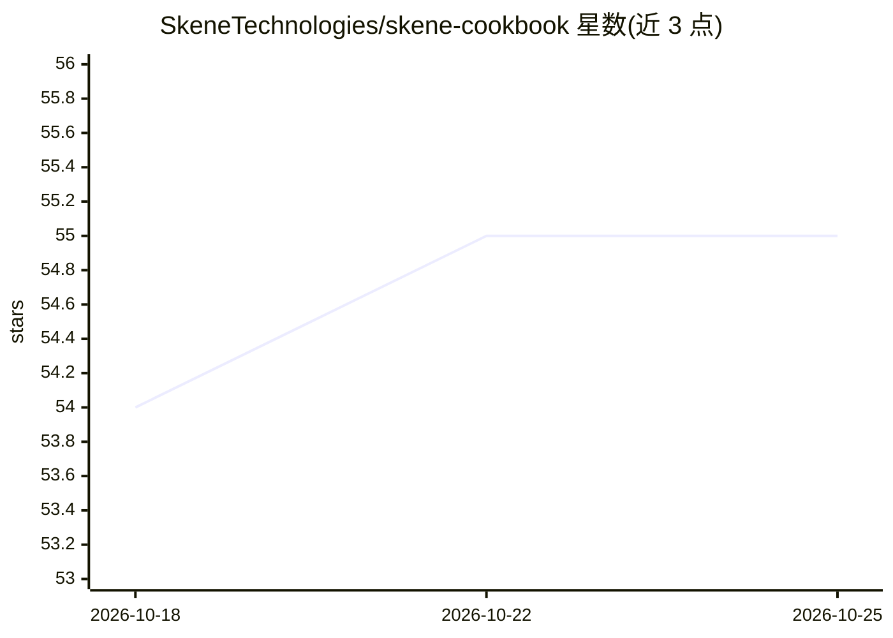

# SkeneTechnologies/skene-cookbook

⭐ 55 · Python · MIT · 推送 2026-02-15 · [GitHub](https://github.com/SkeneTechnologies/skene-cookbook) · 组织维护

**面向 Cursor/Claude 的 764 个 AI 技能与 36 条技能链配方库**

由 Skene Technologies 维护的 AI 技能聚合库：收录 764 个技能（382 个可执行 + 382 个参考指南，涵盖 PLG、营销、销售、客服、财务、安全等领域）与 36 条由 2-7 个技能组成的多步工作流配方，供 Cursor 与 Claude 的 ~/.cursor/skills/ 与 ~/.claude/skills/ 目录使用。通过 npm 安装后自动激活，附 CLI 管理命令，并提供 Salesforce/HubSpot/Stripe 的集成数据 schemas 供接入业务数据。

## 筛选速览

| 维度 | 判定 | 备注 |
|---|---|---|
| AI 角色 | `ai-knowledge` | 知识聚合/清单类 |
| 许可风险 | `permissive` | MIT |
| 部署形态 | `library` | 以包/库形式分发 |
| 模型依赖 | — | README 未给出锁定关系 |
| 硬件要求 | — | 无带数字的原话,不猜 |
| 安装摩擦 | `low` | 无编译、无系统依赖或容器化 |
| 成熟度 | — | 结构信号不足 |

## 能力要点

- 764 个技能（382 可执行 + 382 参考指南），按 15+ 领域组织
- 36 条技能链配方，每条链 2-7 个技能并配工作流蓝图
- npm 安装后自动写入 Cursor 与 Claude 技能目录
- 内置 Salesforce/HubSpot/Stripe 集成参考 schemas

## 适用场景

- 不想从零写 agent 代码，直接套用线索评分、流失预警等工作流
- 为 Cursor/Claude 环境批量安装领域技能与 IDE 规则
- 按角色（销售、增长、财务、科研）查找现成 AI 工作流

## 场景标签

`工作流自动化` `精选清单` · 领域:效率与自动化

## 证据(README 行号)

> L14: If you're trying to ship something like lead scoring, churn alerts, or a content pipeline without months of custom 
> L29: Or browse the Skill Chain Cookbook (36 recipes) → · browse 764 skills →

## 星数曲线

2026-10-18 54 → 2026-10-25 55（+1）

---
*卡片 v1 · prompt 1.4 · 生成 2026-10-24 · 置信度 high · 依据 README sha `eef62bc2772e` · [字段定义](../../DATASET.md)*
