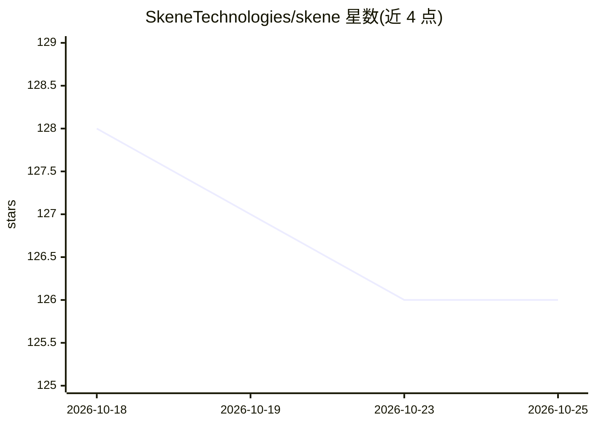

# SkeneTechnologies/skene

⭐ 126 · Go · MIT · 推送 2026-09-03 · [GitHub](https://github.com/SkeneTechnologies/skene) · [官网](https://pypi.org/project/skene/) · 组织维护

**读取代码库生成产品用户旅程分析的 CLI/TUI 工具**

面向做产品增长（PLG）分析与代码文档的开发者：Skene 读取代码库与 SQL schema，由两个并行 agent（代码 agent 与 schema agent）分别提出候选里程碑，合并归类为七阶段用户旅程（发现/上手/激活/参与/留存/扩展/传播），输出 journey.yaml 并以本地 Web 应用渲染可视化。每个里程碑带 tracked_event、confidence 分数与指回代码/表/配置文件的证据链。支持 OpenAI、Gemini、Claude、LM Studio、Ollama 及 OpenAI 兼容端点；提供 curl 安装的 Go TUI 向导与 uvx 运行的 Python CLI，MIT 许可。

## 筛选速览

| 维度 | 判定 | 备注 |
|---|---|---|
| AI 角色 | `ai-native` | 本体是模型或模型工具 |
| 许可风险 | `permissive` | MIT |
| 部署形态 | `library` | 以包/库形式分发 |
| 模型依赖 | local-ok | 支持本地模型 |
| 硬件要求 | — | 无带数字的原话,不猜 |
| 安装摩擦 | `low` | 无编译、无系统依赖或容器化 |
| 成熟度 | — | 结构信号不足 |

## 能力要点

- 双 agent 并行分析代码库与 SQL schema，合并为七阶段旅程
- 里程碑带 tracked_event、confidence 与可点击证据链
- TUI 渲染本地 Web 可视化界面
- 支持 OpenAI/Gemini/Claude/LM Studio/Ollama 及 OpenAI 兼容端点

## 适用场景

- 分析自家产品代码库，生成用户生命周期旅程图
- 为增长策略梳理各阶段里程碑并核对代码证据
- 仅从 *.sql schema 或仅从代码生成旅程分析

## 场景标签

`数据分析` · 领域:效率与自动化

## 证据(README 行号)

> L22: - **Agentic analysis** — two parallel agents read your project: one walks the codebase, one walks your SQL schemas.
> L28: Supports OpenAI, Gemini, Claude, LM Studio, Ollama, and any OpenAI-compatible endpoint.

## 星数曲线

2026-10-18 128 → 2026-10-25 126（-2）

---
*卡片 v1 · prompt 1.4 · 生成 2026-10-23 · 置信度 high · 依据 README sha `6a5ab555d4fb` · [字段定义](../../DATASET.md)*
