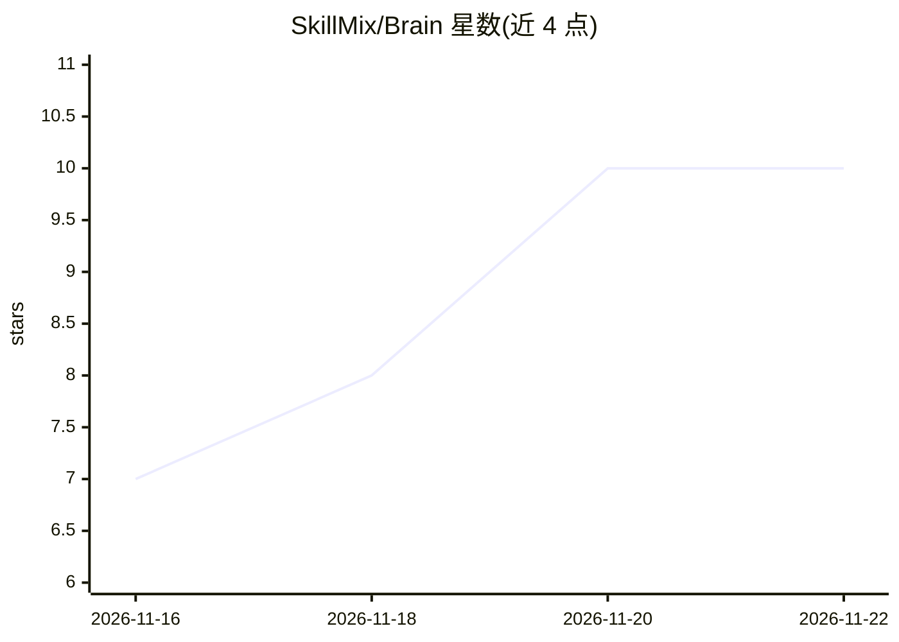

# SkillMix/Brain

⭐ 10 · Python · MIT · 推送 2026-11-17 · [GitHub](https://github.com/SkillMix/Brain) · 组织维护

**给团队提供由 AI agent 维护、带来源与签核的公司知识库模板**

一个以 git 仓库为载体的公司知识库模板：agent 读取邮件、聊天、日程与文档，将记录写入带来源的私有仓库；按 company/walled/owner 三级分类决定信息流向，起草页须经人工签核后才转为 stable，并附文本指纹；每日重建状态页与晨报，回答末尾列出所依据页面及其时效。运行依赖 Claude Code 与 GitHub 账号，无自有服务器或托管服务；当前为 alpha（0.x），小版本可能变更结构。

## 筛选速览

| 维度 | 判定 | 备注 |
|---|---|---|
| AI 角色 | `ai-native` | 本体是模型或模型工具 |
| 许可风险 | `permissive` | MIT |
| 部署形态 | `library` | 以包/库形式分发 |
| 模型依赖 | — | README 未给出锁定关系 |
| 硬件要求 | — | 无带数字的原话,不猜 |
| 安装摩擦 | `low` | 无编译、无系统依赖或容器化 |
| 成熟度 | `idea` | |

## 能力要点

- 每条回答列出所依据页面、层级与数据年龄
- client/project/deal 信息在 owner agent 分类前不离开原空间
- 页面须人工签核（附批准文本的 fingerprint）才转 stable
- secret 扫描阻止密钥入库，个人记录只计数不存储

## 适用场景

- 把散落在邮件、聊天、日程里的公司知识汇总成可溯源的 wiki
- 让 agent 每天生成晨报与状态页，人工只处理待签核清单
- 多成员协作时按项目隔离客户敏感信息

## 场景标签

`知识库管理` · 领域:知识与检索

## 证据(README 行号)

> L3:  A company memory your AI agents keep and your people sign.
> L23: and it sets this up: your agent keeps everything in git with a source on every line, and
> L185: - **Claude Code**, on your own plan or API key. Each person's routines are four agent runs a

## 星数曲线

2026-11-16 7 → 2026-11-22 10（+3）

---
*卡片 v1 · prompt 1.4 · 生成 2026-11-20 · 置信度 mid · 依据 README sha `9a93e73cefe0` · [字段定义](../../DATASET.md)*
