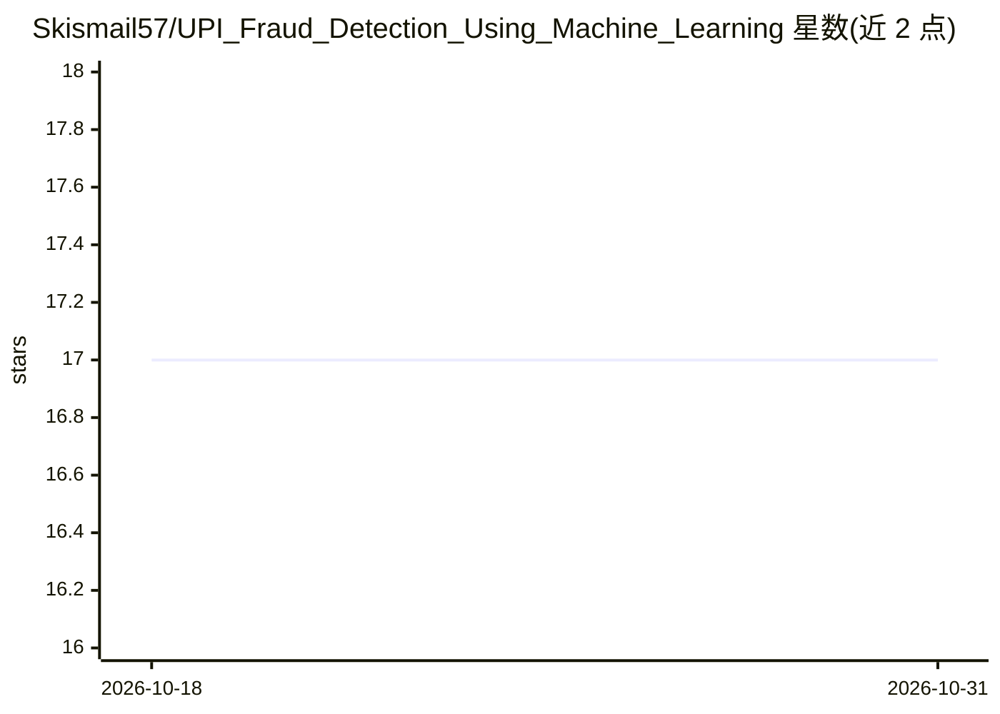

# Skismail57/UPI_Fraud_Detection_Using_Machine_Learning

⭐ 17 · Python · MIT · 推送 2026-07-20 · [GitHub](https://github.com/Skismail57/UPI_Fraud_Detection_Using_Machine_Learning) · 个人维护

**面向 UPI 支付网络的机器学习欺诈交易检测系统**

用机器学习与深度学习检测 UPI 支付网络中欺诈交易的系统：实时交易监控、多模型集成检测（scikit-learn/XGBoost/LightGBM、PyTorch 与图神经网络）、可解释 AI 标记原因、交互式仪表盘可视化，并通过 FastAPI 提供 API 层便于接入支付系统。架构包含数据接入、特征工程、模型集成、决策引擎、API 与仪表盘六层，支持 Docker/Kubernetes 部署与 Prometheus/Grafana 监控集成。以 Python 源码仓库形式提供，克隆后 pip 安装依赖运行。

## 筛选速览

| 维度 | 判定 | 备注 |
|---|---|---|
| AI 角色 | `ai-native` | 本体是模型或模型工具 |
| 许可风险 | `permissive` | MIT |
| 部署形态 | `library` | 以包/库形式分发 |
| 模型依赖 | — | README 未给出锁定关系 |
| 硬件要求 | — | 无带数字的原话,不猜 |
| 安装摩擦 | `low` | 无编译、无系统依赖或容器化 |
| 成熟度 | — | 结构信号不足 |

## 能力要点

- 多模型集成检测（XGBoost/LightGBM/PyTorch/图神经网络）
- 实时交易监控与欺诈模式仪表盘可视化
- FastAPI 接口便于与支付系统集成
- 可解释 AI 输出交易被标记的原因

## 适用场景

- 支付平台对 UPI 交易做实时欺诈识别
- 分析欺诈模式与系统检测表现
- 通过 API 将欺诈判定嵌入现有支付流程

## 场景标签

`网络安全` · 领域:学习与行业

## 证据(README 行号)

> L5: A comprehensive machine learning-based system for detecting fraudulent transactions in UPI (Unified Payments Interfa
> L14: - **Multi-model Ensemble Detection**: Combines multiple ML models for higher accuracy

## 星数曲线

2026-10-18 17 → 2026-10-31 17（+0）

---
*卡片 v1 · prompt 1.4 · 生成 2026-10-29 · 置信度 mid · 依据 README sha `72c0eaa678a6` · [字段定义](../../DATASET.md)*
