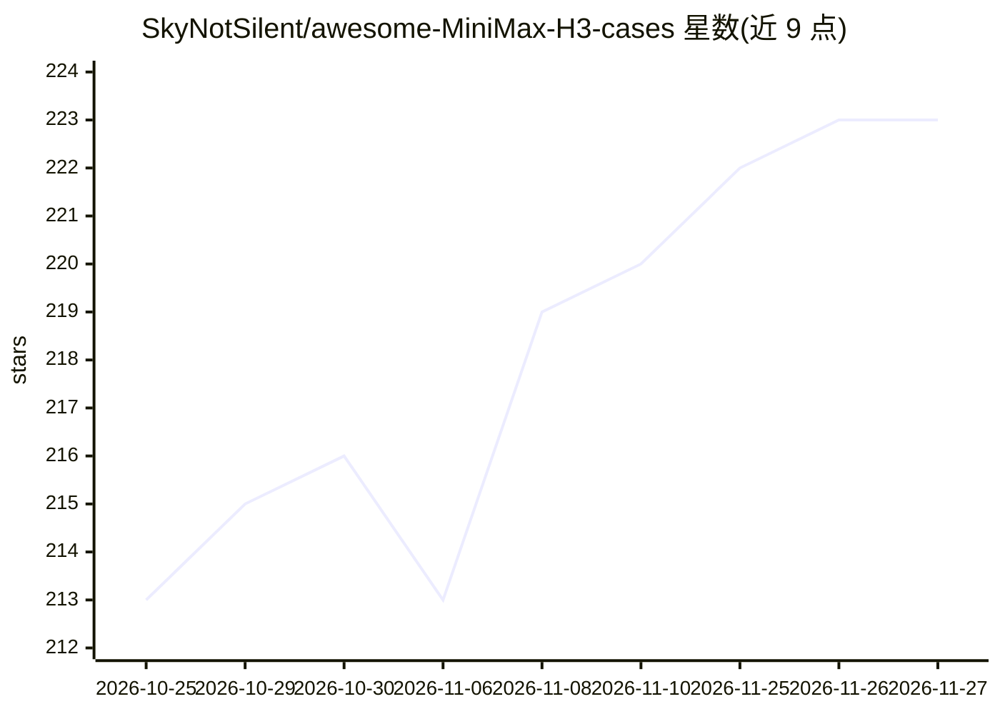

# SkyNotSilent/awesome-MiniMax-H3-cases

⭐ 223 · JavaScript · MIT · 推送 2026-11-07 · [GitHub](https://github.com/SkyNotSilent/awesome-MiniMax-H3-cases) · [官网](https://awesome-minimax-h3-cases.zzskysilent.com) · 个人维护 · 中文 README

**MiniMax H3 视频案例库：案例、公开 Prompt 与教程的溯源聚合**

以目录站点形式聚合 MiniMax H3（Hailuo H3）的公开视频案例、完整公开 Prompt 与教程，共 3145 个可播放案例、781 条完整 Prompt、26 篇教程，双语呈现，标注来源与创作者，不重建或推断缺失的 Prompt。提供按日期/时长/风格/场景筛选、收藏同步，及按目标与硬件（NVIDIA/Apple Silicon/低显存）分路径的教程索引。提供三个可安装到 Codex/Claude Code 的 Agent Skill，作为查询客户端返回真实来源内容。案例数据每日自动发现并经人工源核查。

## 筛选速览

| 维度 | 判定 | 备注 |
|---|---|---|
| AI 角色 | `ai-knowledge` | 知识聚合/清单类 |
| 许可风险 | `permissive` | MIT |
| 部署形态 | `library` | 以包/库形式分发 |
| 模型依赖 | — | README 未给出锁定关系 |
| 硬件要求 | — | 无带数字的原话,不猜 |
| 安装摩擦 | `low` | 无编译、无系统依赖或容器化 |
| 成熟度 | — | 结构信号不足 |

## 能力要点

- 3145 个来源可溯源的 H3 可播放案例，保留原出处与创作者
- 781 条完整逐字公开 Prompt，与未公开 Prompt 明确区分
- 按目标与硬件（NVIDIA/Apple Silicon/8-12GB 显存/Turbo）分路的教程索引
- 三个 Agent Skill（Prompt 库/教程导航/投稿助手）可装入 Codex 与 Claude Code

## 适用场景

- 先看真实 H3 生成结果，再查完整 Prompt 学习创作
- 按自己显卡和目标挑选教程路线生成视频
- 投稿自己的 H3 教程或案例获得展示

## 场景标签

`视频生成` `精选清单` `教程课程` · 领域:内容生成

## 证据(README 行号)

> L5: **A source-attributed MiniMax H3 library with 3145 playable videos, 781 complete public Prompts, and 26 practical gu
> L26: MiniMax H3 is also searched as **Hailuo H3**, **Hailuo 3.0**, and **海螺 H3**. Every published case plays inside the 
> L64: ## Agent Skills

## 星数曲线

2026-10-25 213 → 2026-11-27 223（+10）

---
*卡片 v1 · prompt 1.4 · 生成 2026-11-25 · 置信度 high · 依据 README sha `35246d8cc53b` · [字段定义](../../DATASET.md)*
