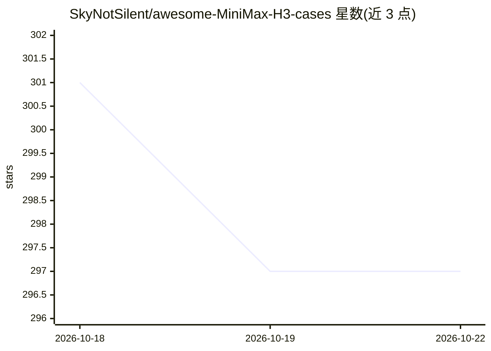

# SkyNotSilent/awesome-MiniMax-H3-cases

⭐ 211 · JavaScript · MIT · 推送 2026-10-21 · [GitHub](https://github.com/SkyNotSilent/awesome-MiniMax-H3-cases) · [官网](https://awesome-minimax-h3-cases.zzskysilent.com) · 个人维护 · 中文 README

**MiniMax H3 / 海螺 H3 视频案例库：可播放案例、完整 Prompts 与教程**

面向视频创作者与学习者的 MiniMax H3（亦称 Hailuo H3 / 海螺 3.0）策展库：收录 2940 条带来源的视频案例、756 条完整公开 Prompt 与 26 篇教程，按日期、时长、类别、风格、场景筛选，站内可直接播放并保留原始出处。Prompt 仅收录来源完整发布的逐字文本，不重构、不改写缺失 Prompt。提供按目标/硬件（NVIDIA/Apple Silicon/低显存）选择的学习路线、三个可安装到 Codex 与 Claude Code 的 Agent Skills（npx skills add），以及 git clone + npm ci 的本地运行方式。声明与 MiniMax 无关联。

## 筛选速览

| 维度 | 判定 | 备注 |
|---|---|---|
| AI 角色 | `ai-knowledge` | 知识聚合/清单类 |
| 许可风险 | `permissive` | MIT |
| 部署形态 | `library` | 以包/库形式分发 |
| 模型依赖 | — | README 未给出锁定关系 |
| 硬件要求 | — | 无带数字的原话,不猜 |
| 安装摩擦 | `low` | 无编译、无系统依赖或容器化 |
| 成熟度 | — | 结构信号不足 |

## 能力要点

- 2940 条来源可溯案例、756 条完整公开 Prompt、26 篇教程（截至 2026-10-21 核查）
- Prompt 仅收录来源完整逐字文本，不重构/改写/逆向
- 三个 Agent Skills 可安装至 Codex 与 Claude Code
- git clone + npm ci 本地运行，公开目录无需生产凭证

## 适用场景

- 浏览带来源的 H3 生成视频寻找灵感
- 筛选完整 Prompt 文本并核对原始出处
- 按目标与硬件（NVIDIA / Apple Silicon / 低显存）选择学习路线

## 场景标签

`视频生成` `精选清单` `教程课程` · 领域:内容生成

## 证据(README 行号)

> L5: **A source-attributed MiniMax H3 library with 2940 playable videos, 756 complete public Prompts, and 26 practical gu
> L26: MiniMax H3 is also searched as **Hailuo H3**, **Hailuo 3.0**, and **海螺 H3**. Every published case plays inside the 

## 星数曲线

2026-10-18 301 → 2026-10-22 297（-4）

---
*卡片 v1 · prompt 1.4 · 生成 2026-10-21 · 置信度 high · 依据 README sha `54727285e82f` · [字段定义](../../DATASET.md)*
